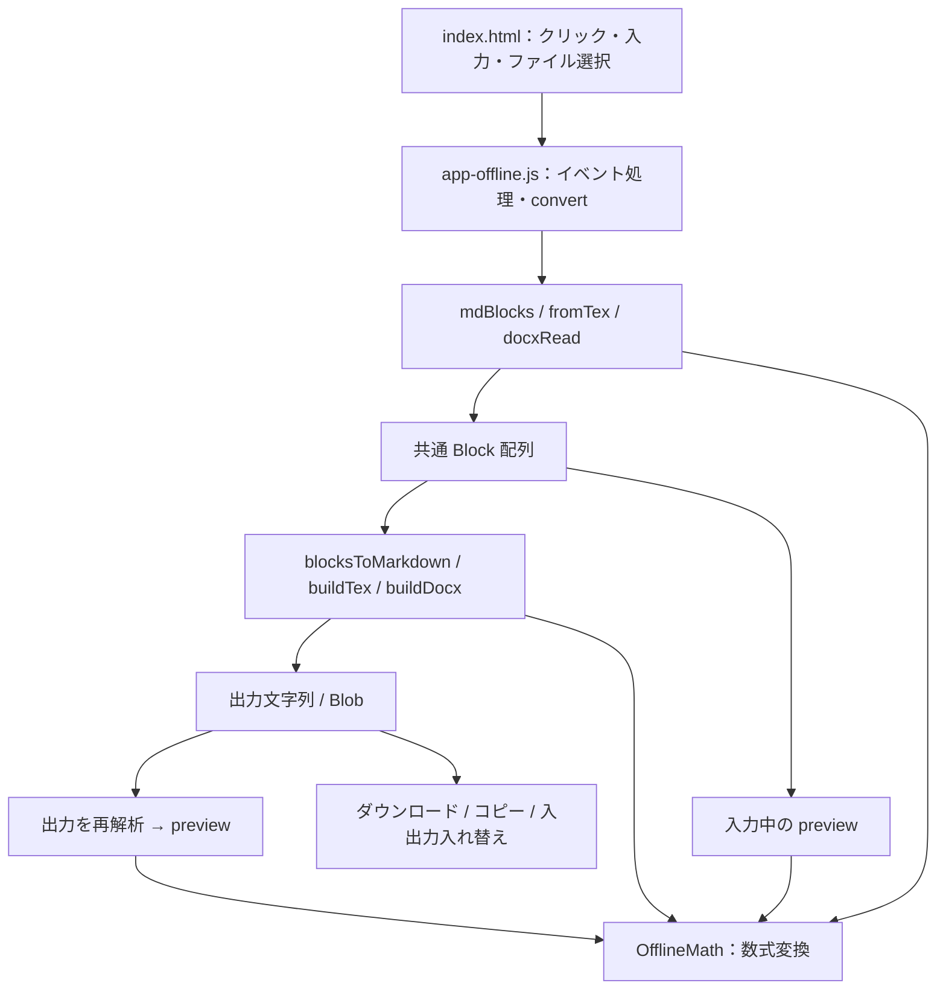

# 文書変換：ユーザー操作・対応機能・JavaScript関数リファレンス

調査対象：[`tmz-spm/md_doc_transformer`](https://github.com/tmz-spm/md_doc_transformer)、`main` のコミット [`3fd645493724c33df29f78b18596ae4760466ef1`](https://github.com/tmz-spm/md_doc_transformer/commit/3fd645493724c33df29f78b18596ae4760466ef1)（2026-11-16確認）。

画面の文言・DOM IDは `index.html`、操作の呼び出し先は `app-offline.js`、変換の実装は `engine-offline.js` と `math-support.js` を根拠に記載した。既存の `SUPPORTED_FEATURES.md` と照合し、操作説明と関数リファレンスをこの1ファイルに統合している。静的なソース調査に基づく資料であり、実ブラウザやMicrosoft Wordでの動作確認結果を表すものではない。

## 目次

- [1. 全体構成と読み方](#1-全体構成と読み方)
- [2. ユーザー操作から関数への対応](#2-ユーザー操作から関数への対応)
- [3. 対応機能ごとの実装](#3-対応機能ごとの実装)
- [4. 共通データと入出力の型](#4-共通データと入出力の型)
- [5. JavaScriptファイル・関数リファレンス](#5-javascriptファイル関数リファレンス)
- [6. 制限・エラー・実装上の注意](#6-制限エラー実装上の注意)
- [7. 実装ソース全文](#7-実装ソース全文)

## 1. 全体構成と読み方

`C` は `window.OfflineConverter`、`M` は `window.OfflineMath` の略記。`a → b` は呼び出し順、`匿名ハンドラー` はイベントに直接代入された無名関数を示す。説明のためのイベント名を実在する関数名と混同しないこと。



実行時のJS読み込み順は **`vendor/math-libraries.js` → `engine-offline.js` → `app-offline.js`**。いずれも `defer` 付きで、DOM解析後にこの順序で実行する。`math-support.js` 自体はHTMLから直接読み込まず、バンドルの生成元として使う。ブラウザ内で処理し、変換用サーバー・Pandoc・WASM・Workerは使わない。

## 2. ユーザー操作から関数への対応

### 2.1 入力・ファイル・編集

以下のイベント処理はすべて `app-offline.js` にある。

| ユーザーが押す・操作するもの | DOM ID / イベント | 直接呼ばれる処理 → 主な後続関数 | 結果 |
| --- | --- | --- | --- |
| 「入力」の形式を選ぶ | `from` / `change` | 匿名ハンドラー → `setInputTab('source')` → `inputChanged()` → `invalidate()` → `scheduleLivePreview()` | Word用のファイル欄／テキスト編集欄を切り替え、以前の出力を無効化する。形式を選ぶだけでは元のテキストを変換しない |
| 「出力」の形式を選ぶ | `to` / `change` | `invalidate()` | 以前の変換結果と保存・コピー可否をリセットし、次の変換先を設定する |
| 「ファイルを開く」 | `open` または `choose-docx` / `click` | 匿名ハンドラー → `file.click()` | OSのファイル選択ダイアログを開く。この時点では変換しない |
| ダイアログで入力ファイルを選ぶ | `file` / `change` | async匿名ハンドラー → `importFile(file)` → `invalidate()`・`setInputTab()`・`inputChanged()`・`scheduleLivePreview(true)`・`status()` | 拡張子から入力形式を判定。テキストは `file.text()` で読み、Wordは `inputFile` に保持する。Wordの解析は「変換」時に行う |
| 入力欄にファイルをドロップ | `drop-area` / `drop` | async匿名ハンドラー → `importFile(files[0])` | ファイル選択と同じ。複数ドロップしても先頭の1ファイルだけを読む |
| ドラッグ中に入力欄へ出入りする | `drop-area` / `dragenter`・`dragover`・`dragleave`・`drop` | 匿名ハンドラー → `preventDefault()`、`classList.add/remove('drag')` | ドロップ領域の見た目を変更する |
| Markdown／TeXを入力・貼り付け | `editor` / `input` | 匿名ハンドラー → `invalidate()` → `scheduleLivePreview()`、`inputChanged()`、`status()` | 約90ms後に入力を再解析してプレビュー。保存用の出力はまだ作らない |
| 入力側「ソース」 | `edit-source-tab` / `click` | `setInputTab('source', true)` | ソース編集欄を表示してフォーカスする |
| 入力側「プレビュー」 | `edit-preview-tab` / `click` | `setInputTab('preview', true)` → `scheduleLivePreview(true)` → `livePreview()` | 入力プレビューを直ちに描画してフォーカスする |
| ソース欄でTab | `editor` / `keydown` | 匿名ハンドラー → `preventDefault()` → `setInputTab('preview', true)` | 入力プレビューに切り替える。通常のTab文字は挿入しない |
| 入力プレビュー自身にフォーカスしてTab | `input-preview` / `keydown` | 匿名ハンドラー → `setInputTab('source', true)` | ソースへ戻る。修飾キーなしのTabのみ対象。プレビュー内リンクなどを対象とするキー操作には適用しない |
| 「サンプル」 | `sample` / `click` | 匿名ハンドラー → `setInputTab()` → サンプル代入 → `invalidate()` → `inputChanged()` → `status()` | 入力形式に応じた例文と数式を挿入。ファイル名の基部を `sample` にする。Word入力時は非表示 |
| 「クリア」 | `clear` / `click` | 匿名ハンドラー → `setInputTab()` → 編集値・`inputFile`を消去 → `invalidate()` → `inputChanged()` → `status()` | 文書入力と変換結果を消去し、ファイル名の基部を `document` に戻す。追加済み関連ファイルは残る |

`invalidate()` は `output=null` にし、ダウンロード・コピー・結果ソースタブを無効にする。続けてライブプレビューを予約するため、入力内容や出力形式を変更した後はもう一度「変換」が必要。

### 2.2 変換と6方向の呼び出し

共通の入口は「変換」ボタン `convert.onclick = convert`。テキスト編集欄の **Ctrl+Enter／Cmd+Enter** も `convert()` を呼ぶ。キー操作は `editor` に設定されており、画面全体のショートカットではない。

| ユーザーの設定と操作 | 読み込み → 書き出し | 出力後の再解析 → 表示 |
| --- | --- | --- |
| 入力Markdown・出力Word →「変換」 | `convert()` → `C.mdBlocks(editor.value)` → `await C.buildDocx(blocks, available, warnings)` | `await C.docxRead(blob)` → `C.preview(actual.blocks, …)` |
| 入力Markdown・出力TeX →「変換」 | `convert()` → `C.mdBlocks()` → `await C.buildTex(blocks, standalone.checked, available, warnings)` | `C.fromTex(tex.text)` → `C.preview()` |
| 入力TeX・出力Markdown →「変換」 | `convert()` → `C.fromTex(editor.value)` → `C.blocksToMarkdown(blocks)` | `C.mdBlocks(txt)` → `C.preview()` |
| 入力TeX・出力Word →「変換」 | `convert()` → `C.fromTex()` → `await C.buildDocx()` | `await C.docxRead(blob)` → `C.preview()` |
| 入力Word・出力Markdown →「変換」 | `convert()` → `await C.docxRead(inputFile)` → `C.blocksToMarkdown(imported.blocks)` | `C.mdBlocks(txt)` → `C.preview()` |
| 入力Word・出力TeX →「変換」 | `convert()` → `await C.docxRead(inputFile)` → `await C.buildTex()` | `C.fromTex(txt)` → `C.preview()` |

`convert()` の詳細な順序：

1. `busy`、Wordのファイル未選択、テキスト入力の空欄を確認する。
2. `invalidate()` → `setBusy(true)` → `status('変換中…')`。`setTimeout(resolve, 0)` を待って進行表示を描画できるようにする。
3. 入力をBlock配列へ解析する。Wordの場合は取り出した画像も `available` に統合する。
4. 出力形式に応じてBlob／文字列を生成する。`buildDocx()` と `buildTex()` の注意を共通配列に集める。
5. **生成した出力そのものを再解析**して `displayBlocks` を得る。
6. Markdown／TeX出力は `imageReferences()` → `localImage()` で使われた画像を収集し、画像があれば文書と一緒に `zipWrite()` でZIPにする。
7. `output={blob,txt,name,resources,archive}` を保存する。`preview()` で再解析結果を表示し、保存・ソース・コピーの可否を更新する。
8. `getNotices()` と各変換の注意を重複除去して「変換時の注意」へ表示する。
9. 例外時は `status(…, 'error')`、`finally` で `setBusy(false)`。

### 2.3 結果・保存・再変換

| ユーザー操作 | DOM ID / イベント | 呼び出し・処理 | 結果・条件 |
| --- | --- | --- | --- |
| 結果側「プレビュー」 | `preview-tab` / `click` | 匿名ハンドラー → `showTab(false)` | すでに生成済みのプレビューへ切り替える。再変換はしない |
| 結果側「ソース」 | `source-tab` / `click` | 匿名ハンドラー → `showTab(true)` | `output.txt` を表示。Word出力ではボタン無効 |
| 「コピー」 | `copy` / `click` | async匿名ハンドラー → `navigator.clipboard.writeText(output.txt)` | Markdown／TeXの文字列をコピー。画像ファイルはコピーしない |
| クリップボードAPIが失敗する | 同上 / `catch` | `source` を表示 → `select()` → `document.execCommand('copy')` → `showTab(true)` → `status()` | 旧APIでコピーを試みる。`execCommand()` の戻り値自体は検証していない |
| 「ダウンロード」 | `download` / `click` | 匿名ハンドラー → `URL.createObjectURL()` → 一時`a`要素の `click()` → 約4秒後 `URL.revokeObjectURL()` | 画像を同梱する場合は `baseName-with-assets.zip`、それ以外は `output.name` を保存。ここで再変換はしない |
| 中央の「⇄」 | `swap` / `click` | 匿名ハンドラー → 入出力形式を交換 → Wordは `new File([output.blob], output.name, …)`、テキストは `editor.value=output.txt` → `updateResourceCount()`（テキスト時）→ `invalidate()` → `inputChanged()` → `status()` | 変換結果を次の入力に移す。未変換ならエラー表示。交換後の変換は別途「変換」を押す |
| 「変換時の注意」を開閉 | `warnings` / ネイティブ`details` | アプリ側JSハンドラーなし | 生成済み注意文の開閉のみ |

### 2.4 関連画像・オプション・ヘルプ

| ユーザー操作 | DOM ID / イベント | 直接処理 → 後続関数 | 結果・条件 |
| --- | --- | --- | --- |
| 「オプション」を開閉 | ネイティブ`details` | アプリ側JSハンドラーなし | 設定欄の表示を切り替える |
| 「画像・関連ファイルを追加」 | `add-resources` / `click` | 匿名ハンドラー → `resources.click()` | 複数ファイル選択を開く |
| 画像／ZIPを選ぶ | `resources` / `change` | async匿名ハンドラー → `addResources(files)` → ZIPなら `await C.zipRead(file)` → `C.normalize(name)` → `updateResourceCount()` → `invalidate()` → `status()` | 通常ファイルはファイル名、ZIPは展開した相対パスをキーに保持する。既存と同じキーは上書きする |
| 関連ファイルの「解除」 | `remove-resources` / `click` | 匿名ハンドラー → `resources={}` → `updateResourceCount()` → `invalidate()` | 関連ファイルをすべて解除。文書入力は保持する |
| 「TeXにプリアンブルを含める」 | `standalone` / `change` | `invalidate()`。次の変換で `buildTex(blocks, checked, …)` → `toTex()` | チェック時はLuaLaTeX向け `ltjsarticle` とパッケージ宣言を付ける。TeX以外の出力にも変更イベントは作用するが、出力生成では使わない |
| 「Wordのスタイルを指定（未対応）」 | `add-reference` | 起動時に `disabled=true`。クリック処理なし | 参照テンプレート指定は未実装。`reference` 入力にも読み込みイベントなし |
| 「対応表 ↗」 | `help` / `click` | 匿名ハンドラー → `help-dialog.showModal()` | HTML内の対応表を表示する |
| 対応表の「✕」 | `close-help` / `click` | 匿名ハンドラー → `help-dialog.close()` | ダイアログを閉じる |
| 「詳細な対応表」「ライセンス」リンク | HTMLの`a` | アプリ側JSハンドラーなし | 同梱Markdown／テキストを別タブで開く。配布版の対応表リンクはビルドでREADMEへ差し替える |
| 「キャンセル」 | `cancel` | 起動時に非表示。ハンドラーなし | 実行中の変換キャンセル機能はない |

起動時はイベント登録、未対応UIの無効化の後、`inputChanged()` → `scheduleLivePreview(true)` → `status('準備完了','success')` が実行される。

## 3. 対応機能ごとの実装

**書式を挿入する専用ツールバーボタンはない。** ユーザーはMarkdown／TeXの構文を入力するか、該当書式のWordを「ファイルを開く」で選択し、出力形式を選んで「変換」を押す。入力時の表示は `livePreview()`、保存用の変換は `convert()` が入口となる。

下表の `docxRead.*`、`docxMake.*`、`preview.*` は各関数内のローカル関数を表す。`*.switch` は分岐処理であり、関数名ではない。

| 機能 | 入力例・ユーザー操作 | 読み込みの担当 | 書き出し・表示の担当 | 保持範囲・注意 |
| --- | --- | --- | --- | --- |
| 段落 | 本文を入力 →「変換」 | `mdBlocks()` / `fromTex()` / `docxRead.para()` → `p` | `blocksToMarkdown()` / `toTex()` / `docxMake.paragraph()` / `preview()` | 基本対応。Markdownの通常改行は段落内で空白にまとめる |
| 見出し | `# 見出し` / `\section{見出し}` | `mdBlocks()` / `fromTex()` / `docxRead.para()` → `heading` | 各出力関数の `heading` 分岐、プレビューは`h1`〜`h6` | MarkdownとWordは1〜6、TeXの6段階目は5段階目と同じ `subparagraph` へ縮退 |
| 太字 | `**太字**` / `__太字__` / `\textbf{太字}` | `inlineParts()` / `texInline()` / `docxRead.formatRun()` | `inlineTex()` → `textbf`、`docxMake.runInline()` → `w:b`、`preview.renderInline()` → `strong` | 単純な文字列が対象。以下の文字装飾も同じ3経路 |
| 斜体 | `*斜体*` / `_斜体_` / `\emph{斜体}` | 同上 → `italic` | `inlineTex()` → `emph`、`runInline()` → `w:i`、`renderInline()` → `em` | `textit` も読み込み可能 |
| 取り消し線 | `~~文字~~` / `\sout{文字}` | 同上 → `strike` | `inlineTex()` → `sout`、`runInline()` → `w:strike`、`renderInline()` → `s` | 基本対応 |
| 下線 | `<u>文字</u>` / `\underline{文字}` | 同上 → `underline` | `inlineTex()` → `underline`、`runInline()` → `w:u`、`renderInline()` → `u` | 任意HTML全体を解釈する機能ではない |
| 黄色マーカー | `==文字==` / `\colorbox{yellow}{文字}` | 同上 → `highlight` | `inlineTex()` → `colorbox`、`runInline()` → `w:highlight`、`renderInline()` → `mark` | 黄色のみ。Word読込では対象の黄色shadingも判定 |
| 上付き | `x<sup>2</sup>` / `\textsuperscript{2}` | 同上 → `sup` | `inlineTex()` → `textsuperscript`、`runInline()` → `w:vertAlign`、`renderInline()` → `sup` | 文字装飾としての上付き。数式内の添字は数式経路 |
| 下付き | `H<sub>2</sub>O` / `\textsubscript{2}` | 同上 → `sub` | `inlineTex()` → `textsubscript`、`runInline()` → `w:vertAlign`、`renderInline()` → `sub` | 基本対応 |
| 番号なしリスト | `- 項目` / `itemize` | `mdBlocks()` / `fromTex()` / `docxRead.para()` → `list` | `blocksToMarkdown()` / `toTex()` / `docxMake()` / `preview()` | 単層。Wordは `numbering.xml` の番号種別を参照 |
| 番号付きリスト | `1. 項目` / `enumerate` | 同上 → `ordered:true` | TeXは`enumerate`、Wordは`numId=2`、表示は`ol` | 開始番号は通常1に再設定 |
| チェックリスト | `- [x] 完了` / `- [ ] 未完了` | `mdBlocks()` で `☑` / `☐`、Wordは `TaskList` を判定 | `blocksToMarkdown()` で`[x]`等へ復元、Wordは丸印なしTaskList段落、表示は`task-item` | クリック可能なフォーム部品ではない。TeX出力ではリスト項目の文字として保持 |
| 引用 | `> 引用` / `quote` | `mdBlocks()` / `fromTex()` / `docxRead.para()` → `quote` | 各出力分岐／`blockquote` | 単純な引用。飾りの引用線は追加しない |
| 行内コード | バッククォート / `\texttt{code}` | `inlineParts()` / `texInline()` / `docxRead.formatRun()` → `code` | `inlineTex()` / `runInline()` / `renderInline()` | 単一装飾。Wordでは文字スタイルCode |
| コードブロック | コードフェンス / `verbatim` | `mdBlocks()` / `fromTex()` / `docxRead.para()` → `code` | 各出力分岐／`pre > code` | 改行を保持。言語名はMarkdownでは保持できるがWord・TeX経由で失われる |
| 見出し付き表 | Markdownパイプ表、またはWord見出し行付き表 | `mdBlocks()` / `docxRead()` → `table`、`hasHeader:true` | `blocksToMarkdown()` のパイプ表、`docxMake()` の`tblHeader`、`preview()` の`th` | セル結合・幅・揃えは保持しない。TeXの`tabular`経由では見出しの意味が失われる |
| 見出しなし表 | 複数行のHTML表 / TeX `tabular` / Word表 | `mdBlocks()` + `readHtmlTableCell()` / `fromTex()` / `docxRead()` → `hasHeader:false` | `blocksToMarkdown()` + `writeHtmlTableCell()` でHTML表、Word・表示では見出しを追加しない | TeX入力の罫線は`hline`有無、Wordは明示された`tblBorders`から判断 |
| リンク | `[文字](https://example.com)` / `\href{URL}{文字}` | `inlineParts()` / `texInline()` / `docxRead.para()` | `inlineTex()` / `docxMake.runInline()` / `preview.renderInline()` | プレビューでリンク化するのはhttp/httpsのみ。URLや入れ子は限定的 |
| 水平線 | 独立行の`---` / `\hrule` | `mdBlocks()` / `fromTex()` / `docxRead.para()` → `hr` | Markdown`---`、TeX`hrule`、Wordは空段落の下罫線、表示は`hr` | 明示したもののみ。文字としての`---`はWordからの読込でエスケープする |
| 画像 | `` / `\includegraphics{image.png}`、関連画像を追加 →「変換」 | `inlineParts()` / `fromTex()` / `docxRead.readDrawing()`、`localImage()` | `buildDocx()` → `docxMake.runInline()`、`buildTex()` → `toTex()`、`preview.renderInline()` | Word埋込はPNG/JPEG/GIF。TeXのGIFは静止PNG化。Markdown／TeX出力は参照画像をZIP同梱 |
| 行内数式 | `$x_i^2$`、TeXでは`\(…\)`も可能 | `inlineParts()` / `fromTex()` / `docxRead.readMath()` | `M.render()`、`docxMake.mathRun()` → `M.toOmml()`、TeX・Markdownは数式文字列 | Word読込は `M.fromOmml()`。分数・根号・上下添字・ギリシャ文字・積分・総和・行列など |
| 別行数式 | `$$…$$`、TeXの`\[…\]`・`equation`・`align`・`gather` | `mdBlocks()` / `fromTex()` / `docxRead.readMath()` → `math` | `M.render(tex,host,true)`、`mathRun(tex,true)`、TeX`\[…\]`、Markdown`$$` | `align`/`gather`は`aligned`/`gathered`へ変換。番号・参照の保持は対象外 |
| YAMLフロントマター | 文頭`---`とキー・値、終端`---`または`...` | `mdBlocks()` → `frontmatter` | `blocksToMarkdown()` は保存、`preview()`・Word・TeX出力は本文に含めない、`getNotices()`で注意 | Word文書プロパティへの変換はない |
| TeXコメント | `% コメント`、コード中の`%` | `removeTexComments()` → `fromTex()` | 出力・プレビューの本文から除外 | エスケープ済み`\%`と`verbatim`内の`%`は保持 |
| Wordの非表示文字・フィールド命令除外 | Wordを開く →「変換」 | `docxRead.textRun()` | 非表示runを除外、`instrText`等は本文に取り込まない | Wordの全編集用データを網羅するパーサーではない |

### 3.1 画像を含む変換の具体例

1. Markdownに `` と書く。
2. 「オプション」→「画像・関連ファイルを追加」から `images/figure.png` を含むZIPを選ぶ。単独選択した画像はファイル名だけをキーにするため、フォルダー付き参照にはZIPを使う。
3. `addResources()` → `zipRead()` → `normalize()` により `resources['images/figure.png']` を作る。
4. Wordへ変換する場合、`imageReferences()` → `localImage()` → `Image.decode()` で画像サイズを取得し、`docxMake()` で `word/media/` に埋め込む。
5. Markdown／TeXへ変換する場合、出力再解析後の参照を収集し、`zipWrite()` で本文と画像をまとめる。「ダウンロード」はそのZIPを保存する。

### 3.2 数式の呼び出し経路

```text
入力中の描画：livePreview → mdBlocks/fromTex → preview → OfflineMath.render → KaTeX
Wordへ出力 ：convert → buildDocx → docxMake.mathRun → OfflineMath.toOmml
             → KaTeX(MathML生成) → mml2omml → OMML XML
Wordを読込 ：convert → docxRead.readMath → OfflineMath.fromOmml
             → omml2mathml → MathMLToLaTeX.convert → KaTeXによる再検証
```

数式描画失敗は元TeXとエラー用CSS／titleに置き換える。Word書き出し失敗は元TeXを通常文字列として残して注意を追加する。Word読込失敗は取得できる数式文字を残して注意を追加する。

## 4. 共通データと入出力の型

以下の型表記は実装を説明するための擬似TypeScriptであり、リポジトリに型定義があるわけではない。

```ts
type Block =
  | { type: 'p' | 'quote'; text: string }
  | { type: 'heading'; level: number; text: string }
  | { type: 'code'; text: string; lang?: string }
  | { type: 'math'; text: string }
  | { type: 'hr' }
  | { type: 'frontmatter'; text: string }
  | { type: 'list'; ordered: boolean; items: string[]; task?: boolean }
  | { type: 'table'; rows: string[][]; hasHeader?: boolean; borders?: boolean };
type InlinePart = {
  type: 'text' | 'bold' | 'italic' | 'strike' | 'underline' | 'highlight'
      | 'sup' | 'sub' | 'code' | 'math' | 'link' | 'image';
  text: string; href?: string; markup?: string;
};
type Resources = Record<string, Blob | File>; // 正規化した相対パス → ファイル
type ZipFiles = Record<string, string | Uint8Array>;
type ZipReadResult = Record<string, Uint8Array>;
type DocxReadResult = { blocks: Block[]; resources: Resources; warnings: string[] };
type TexResult = { text: string; resources: Resources };
type Output = {
  blob: Blob; txt: string; name: string;
  resources: Resources; archive: Blob | null;
};
```

`Block.text`、リストの`items`、表のセル文字列は、多くの場合Markdown系のインライン記法を持つ。`inlineParts()` が描画・Word書き出し・TeX書き出しの直前に解析する。Block配列はインラインの構文木ではない。`code.text`と`math.text`はそれぞれコード／数式の本体を持つ。

| UI状態 | 初期値 | 役割 |
| --- | --- | --- |
| `inputFile` | `null` | 選択済み、または入れ替えで作ったWord入力File |
| `resources` | `{}` | ユーザーが追加した関連ファイル |
| `output` | `null` | 最後の変換出力。`invalidate()`で破棄 |
| `baseName` | `'document'` | 出力ファイル名の基部。入力ファイル名は安全な文字に置換する |
| `busy` | `false` | 変換実行中の重複操作抑止 |
| `previewUrls` / `inputPreviewUrls` | `[]` / `[]` | 結果側／入力側で生成したBlob URLの解放用リスト |
| `liveTimer` | `null` | 約90msの自動更新予約 |
| `inputTab` | `'source'` | 入力側の表示タブ |

`output.blob` はWord出力でも `zipWrite()` が返すためMIMEは `application/zip`。`.docx` の拡張子で保存する。`output.txt` はWord出力時に空文字列。Markdown／TeX本文BlobのMIMEは `text/plain;charset=utf-8`。

## 5. JavaScriptファイル・関数リファレンス

調査コミットのソース：

- [app-offline.js](https://github.com/tmz-spm/md_doc_transformer/blob/3fd645493724c33df29f78b18596ae4760466ef1/app-offline.js)
- [engine-offline.js](https://github.com/tmz-spm/md_doc_transformer/blob/3fd645493724c33df29f78b18596ae4760466ef1/engine-offline.js)
- [math-support.js](https://github.com/tmz-spm/md_doc_transformer/blob/3fd645493724c33df29f78b18596ae4760466ef1/math-support.js)
- [scripts/browser-dom/index.cjs](https://github.com/tmz-spm/md_doc_transformer/blob/3fd645493724c33df29f78b18596ae4760466ef1/scripts/browser-dom/index.cjs)
- [scripts/vendor-math.mjs](https://github.com/tmz-spm/md_doc_transformer/blob/3fd645493724c33df29f78b18596ae4760466ef1/scripts/vendor-math.mjs)
- [build.mjs](https://github.com/tmz-spm/md_doc_transformer/blob/3fd645493724c33df29f78b18596ae4760466ef1/build.mjs)
- [serve.mjs](https://github.com/tmz-spm/md_doc_transformer/blob/3fd645493724c33df29f78b18596ae4760466ef1/serve.mjs)

戻り値欄の `void` は実質 `undefined` を表す。`async`関数の値はPromiseで包まれる。UI関数は戻り値よりDOMやクロージャ状態の変更を主な出力とする。以下の行番号は冒頭の調査コミットを基準とし、末尾のソース全文にも同じ内容を収録した。

### 5.1 ファイルの中身と責務

| ファイル | 内容・公開先 | 関連する操作 |
| --- | --- | --- |
| `app-offline.js` | 即時実行関数内でUI状態、サンプル、名前付き関数、匿名イベント処理を定義。グローバルへの関数公開なし | 入力・タブ・ファイル・変換・コピー・保存・関連ファイル・対応表 |
| `engine-offline.js` | ZIP、Markdown、TeX、Word OOXML、画像、DOMプレビュー。末尾で13関数を `window.OfflineConverter` に公開 | 全形式の解析・出力とプレビュー |
| `math-support.js` | 4種類の数式ライブラリを接続。ES moduleで3関数をexport | 数式描画、Word OMMLとの相互変換 |
| `vendor/math-libraries.js` | `math-support.js` と依存ライブラリを束ねた生成済みIIFE。`OfflineMath`を公開 | HTMLから実際に読み込まれる数式処理 |
| `scripts/browser-dom/index.cjs` | omml2mathmlが使うDOMをブラウザ組み込みDOMへ置き換えるアダプター | Word数式の読み取りを間接的に支える |
| `vendor/sources/mathml2omml.js` | 同梱ライブラリの未圧縮ソース。通常のHTMLから直接実行するファイルではない | ソース提供用。実際の変換は数式バンドルを通す |
| `scripts/vendor-math.mjs` | esbuildで数式バンドルとライブラリ一覧を生成し、CSS・フォント・ライセンス・ソースを同梱 | 開発者の `npm run vendor:math` |
| `build.mjs` | HTMLの説明リンク差し替え、KaTeX WOFF2のCSS埋め込み、ライセンス統合、配布用9ファイル生成 | 開発者の `npm run build` |
| `serve.mjs` | 静的ファイルをlocalhostで配信 | 開発者の `npm start` |
| `test.mjs` / `tests/browser.js` | 構文解析・ZIP・数式・UI等の検証コード。アプリ機能の実装本体ではない | 開発・回帰検証用。個々のテスト関数は本資料のAPI対象外 |

依存ライブラリ内部の全関数はリファレンス対象外とし、アプリから使用する接点を5.4に記載する。主なバージョンはKaTeX `0.19.1`、mathml2omml `0.5.0`、omml2mathml `1.3.0`、mathml-to-latex `1.8.0`。依存全体は `vendor/manifest.json` とライセンス文書を参照する。

### 5.2 `app-offline.js`：UI制御

参照元：`app-offline.js`。以下は即時実行関数内のローカル関数で、外部APIではない。

| 関数（定義行） | 入力 | 戻り値・副作用 | 機能・主な呼び出し先 |
| --- | --- | --- | --- |
| `$(id)`（3） | DOM ID `string` | `HTMLElement`相当または`null` | `document.getElementById()` の短縮形 |
| `status(s, kind='')`（22） | メッセージ、CSSクラス名 | `void`、`status`の文字列・classを更新 | 準備・編集中・変換成功・エラー表示 |
| `setBusy(on)`（23） | `boolean` | `void`、`busy`・bodyのclass・主要UIのdisabledを更新 | 重複変換と主要設定変更を抑止する。すべての要素を無効にするわけではない |
| `clearPreview()`（24） | なし | `void`、結果側Blob URLをrevokeし配列を空にする | 描画を再作成する前のURL解放。DOM自体の消去は別処理 |
| `clearInputPreview()`（25） | なし | `void`、入力側Blob URLをrevoke | 入力プレビュー用URLの解放 |
| `livePreview()`（26） | 引数なし。`from`・`editor`・`resources`を参照 | `void`、入力プレビューと未変換時の右側プレビューを描画 | `C.mdBlocks()` / `C.fromTex()` → `C.preview()`。Word入力は何もしない。例外は画面メッセージへ |
| `scheduleLivePreview(immediate=false)`（50） | 即時描画するか | `void`、既存タイマーを取り消して即時実行または90ms後に予約 | `livePreview()`。Word入力なら予約しない |
| `invalidate()`（56） | なし | `void`、出力・表示・保存可否をリセット | `clearPreview()` → `scheduleLivePreview()` |
| `setInputTab(next, focus=false)`（64） | `'source'` / `'preview'`、フォーカス指定 | `void`、入力タブ・hidden・ARIA・focusを更新 | プレビュー選択時 `scheduleLivePreview(true)`。Word入力時は無処理 |
| `inputChanged()`（75） | 引数なし。入力形式とファイル・編集値を参照 | `void`、入力欄・サンプル可視性・ファイル名・サイズ・文字数・placeholderを更新 | 入力形式に適した画面状態へ同期する |
| `async importFile(file)`（85） | `File` | `Promise<void>`、入力・形式・基部名・プレビューを更新。形式／サイズ不正はreject | `file.text()`、`invalidate()`、`setInputTab()`、`inputChanged()`、`scheduleLivePreview(true)` |
| `updateResourceCount()`（86） | 引数なし。`resources`参照 | `void`、件数表示と解除ボタンを更新 | `Object.keys(resources).length`を表示 |
| `async addResources(files)`（91） | `FileList`等の反復可能なFile群 | `Promise<void>`、関連ファイルを統合して結果を無効化。エラーはreject | ZIP展開・パス正規化後に全体を反映。途中エラー時は元の`resources`を維持 |
| `showTab(source)`（105） | `boolean`：trueでソース表示 | `void`、結果側のhidden・class・ARIAを更新 | `output`なしは無処理。生成処理は行わない |
| `getNotices(blocks, to, available, displayBlocks)`（106） | 元Block配列、出力形式、利用可能画像、再解析後Block配列 | `string[]` | 一般的な情報欠落、表、YAML除外、TeXの見出し行、画像不足の注意を作る |
| `async convert()`（117） | 引数なし。画面設定・入力・関連ファイルを参照 | `Promise<void>`、`output`・プレビュー・注意・保存可否を更新 | 2.2の全変換フロー。例外は内部で捕捉し、`status()`へ表示する |

無名関数として実装されたダウンロード・コピー・入れ替え・イベントハンドラーの入出力は2章に記載した。`download()`、`copy()`、`swap()`という名前付き関数は存在しない。

### 5.3 `engine-offline.js`：変換エンジン

#### 公開API：`window.OfflineConverter`

| 関数（定義行） | 入力 | 戻り値・副作用 | 機能・主な呼び出し先 |
| --- | --- | --- | --- |
| `zipRead(input, filter)`（33、async） | `Uint8Array`または`arrayBuffer()`を持つBlob/File、任意の`(name:string)=>boolean` | `Promise<ZipReadResult>`。不正ZIP等はreject | 中央ディレクトリを読み、無圧縮／deflate-rawのエントリーを展開。`normalize()`使用 |
| `zipWrite(files)`（21） | `ZipFiles`。内部では各値を文字列または`new Uint8Array(data)`に変換可能なデータとして扱う | `Blob`（`application/zip`） | UTF-8名・CRC32を持つ無圧縮ZIPを生成。`normalize()`・`crc32()`・`concat()`・`u16()`・`u32()` |
| `mdBlocks(src)`（63） | ソース（`String(src)`で文字列化） | `Block[]`。HTML表の解析はDOMが必要 | 改行正規化、フロントマター、フェンス、見出し、水平線、数式、引用、表、リスト、段落を解析 |
| `blocksToMarkdown(blocks)`（111） | `Block[]` | `string`（末尾改行付き） | ブロックをMarkdownへ。見出しなし表はHTMLへ。`writeHtmlTableCell()`使用 |
| `toTex(blocks, standalone=true, resources={}, renamed=new Map())`（196） | Block配列、プリアンブル可否、画像辞書、元パス→変換先パスMap | `string`（末尾改行付き） | TeXを同期生成。`inlineTex()`・`localImage()`。GIF変換は行わない |
| `buildTex(blocks, standalone, resources={}, warnings=[])`（213、async） | Block配列、プリアンブル可否、画像辞書、注意用配列 | `Promise<TexResult>`。`warnings`へ追記 | GIFのPNG化、TeX特殊文字を含む画像名の変更を行い、`toTex()`へ。画像辞書は複製して返す |
| `fromTex(src)`（278） | TeXソース | `Block[]` | `removeTexComments()` → 数式・コード・画像の保護 → 基本構文をMarkdown系へ → `mdBlocks()` |
| `docxRead(input)`（311、async） | ZIPと同じ入力型のdocxデータ | `Promise<DocxReadResult>`。不正な本文・XML等はreject | `zipRead(input, p=>p.startsWith('word/'))`、本文・rels・番号定義を解析。画像・注意も返す |
| `buildDocx(blocks, resources={}, warnings=[])`（470、async） | Block配列、画像辞書、注意用配列 | `Promise<Blob>`（docxとして保存するZIP）。`warnings`へ追記 | 画像サイズのdecode → `docxMake()` → 画像のbytes化 → `zipWrite()`。Blob URLはfinallyで解放 |
| `preview(blocks, host, resources={}, urlList=[])`（494） | Block配列、描画先DOM Element、画像辞書、URL解放用の配列 | `void`、`host`を置換しURLを`urlList`へ追記 | DOM生成で描画。`inlineParts()`・`localImage()`・`OfflineMath.render()`。古いURLの解放は呼び出し側の責任 |
| `normalize(p)`（11） | パス文字列 | 正規化した`string`。上位へ行きすぎる`..`でthrow | バックスラッシュを`/`へ、空要素・`.`を除去、`..`を解決。URL判定は別関数 |
| `localImage(href, resources)`（119） | 画像参照文字列、画像辞書（docx読込ではbytes辞書も渡す） | `{path, file}`または`null`。fileは辞書内の値 | 相対参照か確認し、元文字列・URIデコード後の文字列を正規化して自前キーだけ照合。例外は内部捕捉 |
| `imageReferences(blocks)`（153） | Block配列 | `InlinePart[]`（image型のみ） | 段落・見出し・引用・リスト・表のセルを走査し、`inlineParts()`で画像参照抽出。コード／数式内は対象外 |

`buildTex()` は `standalone` に既定引数を宣言していないが、その値を既定値付きの `toTex()` へ渡すため、`undefined`ならプリアンブル付きになる。UIは必ずチェック状態をbooleanで渡す。

#### 内部ヘルパー：XML・バイナリ・インライン・TeX

| 関数（定義行） | 入力 | 出力・役割 |
| --- | --- | --- |
| `esc(s)`（8） | 任意値 | `string`。XML/HTML用の`& < > " '`をエスケープ。null/undefinedは空文字 |
| `ext(s)`（10） | 任意値 | 最後の`.`以降を小文字化した`string`。ファイルの実データ判定ではない |
| `getChildren(node, tag)`（12） | DOMノード、localName | `Element[]`。直下の一致要素。nodeがなければ空配列 |
| `first(node, tag)`（13） | 同上 | 最初の一致`Element`または`undefined` |
| `at(node, tag, ns=W)`（14） | DOMノード、localName、名前空間 | 子孫の最初の一致`Element`または`undefined` |
| `attr(node, name, ns=W)`（15） | 要素、属性名、名前空間 | `string`。NS属性→`w:`付き→通常属性の順に読む。未取得は空文字 |
| `parseXML(s)`（16） | XML文字列 | `Document`。`parsererror`があればthrow |
| `crc32(bytes)`（17） | バイト列 | unsigned 32bit数値。ZIPのCRC32を計算 |
| `concat(parts)`（18） | `Uint8Array[]` | 連結した`Uint8Array` |
| `u16(v)`（19） | 数値 | 2byteのリトルエンディアン`Uint8Array` |
| `u32(v)`（20） | 数値 | 4byteのリトルエンディアン`Uint8Array` |
| `escapeMdLiteral(text)`（115） | 文字列化可能な値 | `string`。Word由来の通常文字がMarkdown構文へ変化しないようエスケープ |
| `decodeMdEscapes(text)`（116） | 文字列化可能な値 | `string`。上記対象文字のバックスラッシュを除去 |
| `relativeImagePath(href)`（117） | 画像参照文字列 | 相対参照の判定。通常はboolean、空値では短絡評価でfalsy値になり得る。scheme、先頭`/`・`\`、制御文字を拒否 |
| `markdownImage(alt, path)`（132） | 代替文字列、パス文字列 | `string`。代替文字をエスケープし、必要ならパスを`<…>`で囲ったMarkdown画像記法 |
| `readHtmlTableCell(cell)`（137） | HTML表セルElement | `string`。子ノードを文字列へ。直下IMGの相対参照はMarkdown画像記法へ変換 |
| `writeHtmlTableCell(text)`（145） | セル内インライン文字列 | `string`。インラインを解析・エスケープし、相対画像をIMGにする。装飾全般をHTMLタグへ再構築する処理ではない |
| `inlineParts(s)`（163） | インライン文字列 | `InlinePart[]`。装飾・リンク・画像・数式・通常文字を正規表現で分解。奇数本の`\`でエスケープされた構文を除外 |
| `texEscape(s)`（194） | 通常文字列 | `string`。TeX特殊文字をエスケープ |
| `inlineTex(s, imagePath)`（195） | インライン文字列、`(href:string)=>string` | `string`。`inlineParts()`結果を各TeX構文に変換。数式本体は通常文字エスケープを適用せず保持 |
| `texInline(s)`（253） | 基本TeXインライン文字列 | `string`。文字装飾・href等をMarkdown系の記法へ置換しtrim |
| `removeTexComments(src)`（263） | TeXソース | `string`。通常の`%`以後を除去し、verbatimとエスケープ済み`%`を保護 |

#### 関数内のローカル関数

| 所属・関数（定義行） | 入力 | 出力・副作用・役割 |
| --- | --- | --- |
| `mdBlocks.blank()`（65） | なし。現在の`lines[i]`を参照 | `boolean`。空行／入力末尾判定 |
| `mdBlocks.split(x)`（98） | パイプ表1行 | `string[]`。両端パイプを除去し、エスケープされていないパイプでセル分割 |
| `toTex.imagePath(href)`（197） | 参照先 | `string`。`localImage()`の正規化済みパスと`renamed`を反映 |
| `toTex.convertInline(text)`（201） | インライン文字列 | `string`。上の画像解決関数を渡して`inlineTex()`を呼ぶ |
| `fromTex.hold(value)`（283） | 保護する文字列 | 一意なトークン`string`。元文字列を`saved`に追加 |
| `fromTex.restore(value)`（284） | トークンを含む文字列 | `string`。保護した数式・コード・画像・表を復元 |
| `docxRead.readDrawing(drawing)`（329） | Word drawing Element | Markdown画像記法`string`または空文字。`resources`に画像Blob、失敗時`warnings`に追記 |
| `docxRead.textRun(r)`（346） | Word run Element | インライン`string`。文字・改行・Tab・drawingを取り出し、非表示runを除外 |
| `docxRead.formatRun(v, prop)`（362） | 通常文字列、runプロパティElement | `string`。文字をMarkdown用にエスケープし、太字・斜体・下線・色・上下付き・コード書式を付ける |
| `docxRead.readMath(node)`（375） | OMML Element | TeXの`string`または`null`。`M.fromOmml()`失敗時は`warnings`へ追記 |
| `docxRead.para(p)`（379） | Word段落Element | `Block`相当、内部用`listitem`、または`null`。段落のスタイル・番号設定・数式・リンク等を読み取る。呼び出し元が`listitem`を`list`へ統合 |
| `docxMake(blocks, resources, imageSizes, warnings)`（404） | Block配列、画像辞書、`Map<path,{cx,cy}またはnull>`、注意配列 | `{files, assets}`。OOXML文字列群と画像ファイル辞書。注意配列へ追記。まだ最終ZIPではなく、`buildDocx()`がassetsをbytes化する |
| `docxMake.putRun(t, style='')`（406） | 文字列化可能な値、runプロパティXML断片 | XML`string`。テキストをエスケープし、改行／TabをWord要素へ |
| `docxMake.mathRun(tex, display=false)`（407） | TeX数式、別行表示か | OMMLまたはフォールバック通常runのXML`string`。`M.toOmml()` → `parseXML()`、失敗時注意を追記 |
| `docxMake.runInline(s)`（418） | インライン文字列 | run／hyperlink／drawingのXML`string`。リンクrels・画像assets・MIME辞書を更新 |
| `docxMake.paragraph(s, properties='')`（444） | インライン文字列、段落プロパティXML断片 | Word段落XML`string`。`runInline()`を内包 |
| `preview.element(tag, text, into=host)`（495） | タグ名、文字列またはnull、親DOM | 作成・appendしたElement。textは`textContent`へ |
| `preview.renderInline(s, into)`（496） | インライン文字列、親DOM | `void`。装飾要素・安全なリンク・画像・数式を追加。Blob URLを外部配列へ記録 |

### 5.4 `math-support.js`：数式API

`scripts/vendor-math.mjs` がバンドル化した後は `window.OfflineMath` のAPIとして使う。

| 関数（定義行） | 入力 | 出力・副作用 | 機能・例外 |
| --- | --- | --- | --- |
| `options(display)`（6、内部） | 別行表示`boolean` | KaTeXオプションobject | `displayMode`、`throwOnError:true`、`trust:false`、`strict:'ignore'`、`maxExpand:1000`、`maxSize:20` |
| `render(tex, host, display=false)`（8、公開） | TeX文字列、描画先DOM、表示モード | `void`、DOMとCSS／titleを更新 | `katex.render()`。例外時は元TeXを`textContent`に残して`math-error`を付ける |
| `toOmml(tex, display=false)`（18、公開） | TeX文字列、表示モード | OMML XML`string` | `katex.renderToString(output:'mathml')` → annotation除去 → `mml2omml(...,{disableDecode:true})`。別行なら`m:oMathPara`で包む。生成失敗はthrow |
| `fromOmml(node)`（27、公開） | Wordの`oMath`／`oMathPara` Element | TeX`string` | `omml2mathml()` → `XMLSerializer` → `MathMLToLaTeX.convert()` → KaTeXで再検証。空数式・無効構文等はthrow |

### 5.5 DOMアダプターと開発用JS

| ファイル・関数／入口 | 入力 | 出力・副作用 | 用途 |
| --- | --- | --- | --- |
| `scripts/browser-dom/index.cjs` / `exports.document()`（2） | なし | 新しいXMLDocument | `document.implementation.createDocument(null,null)`でomml2mathml向け文書を生成 |
| 同 / `exports.implementation()`（3） | なし | ブラウザの`DOMImplementation` | Node/jsdom依存をブラウザAPIへ置換 |
| `scripts/vendor-math.mjs` / トップレベル | インストール済み依存、math-support、ライセンス | バンドルJS、CSS、フォント、ライセンス、未圧縮ソース、manifestを生成 | `esbuild.build()`、`cp()`、`writeFile()`。ユーザーの画面操作では実行しない |
| `build.mjs` / `read(path)`（6） | リポジトリ基準の相対パス | `Promise<string>` | ビルド元ファイルをUTF-8で読む |
| `build.mjs` / `write(path, content)`（7） | dist基準の相対パス、文字列 | `Promise<void>`、ファイルへ書き込む | 配布ファイル生成 |
| `build.mjs` / トップレベル | ソース、vendor、配布README | `dist/`の9ファイル。既存distは削除して再生成 | フォント・HTMLリンクの整合を確認後、WOFF2をCSSへ埋め込みライセンスを統合。フォント宣言やバイトが不正ならthrow |
| `serve.mjs` / HTTPリクエストのasync匿名コールバック（8） | Nodeの`req`・`res`、CLI引数のルート（既定dist） | HTTP 200とファイルbytes、または404 | localhost:4173。ルート外やドットで始まるパス要素は拒否。ディレクトリはindex.htmlへ解決 |
| `serve.mjs` / listenコールバック（18） | なし | コンソール出力 | 起動先URLを表示 |

## 6. 制限・エラー・実装上の注意

| 条件・機能 | 実装の扱い | 関連関数 |
| --- | --- | --- |
| 入力ファイルの上限 | `30 * 1024 * 1024` bytesを超えるとエラー。関連ファイルも1ファイルごとに同上 | `importFile()` / `addResources()` |
| 入力拡張子 | `.md`・`.markdown`・`.txt`はMarkdown、`.tex`・`.latex`はTeX、`.docx`はWordとして読む | `importFile()` |
| ZIP制限 | 中央ディレクトリ件数2000超、対象ファイル1件の展開宣言サイズ60MiB超、対象合計100MiB超、暗号化、非対応圧縮などはエラー | `zipRead()` |
| ZIPのサイズ検査 | 展開前の宣言サイズと展開後の一致を検査する。実装は出力ストリームを逐次上限停止するものではなく、CRCの再照合もしていない | `zipRead()` |
| 出力に同梱する関連ファイル | Markdown／TeXの再解析結果から解決できた画像が100件を超えるとエラー。文書ファイルはその後に追加する | `convert()` |
| 関連画像のパス | URL・絶対参照は`localImage()`で採用しない。ユーザー提供の相対ファイルだけ解決する | `relativeImagePath()` / `localImage()` |
| 画像不足・非対応・破損 | Word出力は元記法を通常文字として残して注意。プレビューは元記法を文字表示し、画像ロード失敗時も置換する | `docxMake.runInline()` / `preview.renderInline()` |
| GIFとTeX | `createImageBitmap()`・canvasで1枚のPNGへ。失敗は注意を追加し元参照を維持する | `buildTex()` |
| Wordへの画像サイズ | 1pxあたり9525EMUを基準に拡大せず、最大幅5400000・高さ7000000EMUに収まる比率で調整 | `buildDocx()` |
| WordのXML／ZIP破損 | 例外がUIの「変換に失敗しました」へ伝わる | `parseXML()` / `zipRead()` / `convert()` |
| 空入力／未選択Word | 変換処理に入る前にエラーステータス | `convert()` |
| 脚注・入れ子リスト・結合セル・段組み・改ページ | 未対応。完全保持を前提としない | 各パーサー・シリアライザー |
| 複合装飾・複雑なTeX・独自マクロ | 正規表現中心の限定的な構文変換。一般的なMarkdown／LaTeXの完全パーサーではない | `inlineParts()` / `texInline()` / `fromTex()` |
| TeXコンパイル／PDF生成 | 行わない。`.tex`の生成と簡易プレビューまで | `buildTex()` / `preview()` |
| 元表示との一致 | 出力を再読込した簡易HTMLを表示する。Word本体／LaTeX組版エンジンのページ表示とは異なる | `convert()` / `preview()` |
| 未実装の画面要素 | 参照Wordテンプレートは無効、キャンセルは非表示 | `app-offline.js`起動処理 |

画面に出る「複雑な書式・脚注・独自マクロは完全には保持されません。」は `getNotices()` がすべての変換に付ける共通注意。変換関数が追加した個別注意と合わせて表示する。

## 7. 実装ソース全文

関数リファレンスから実装内容までこのMarkdown内で参照できるよう、調査コミットの自作実装を以下に収録する。生成済みの大きな数式バンドルや外部ライブラリ全文は重複掲載せず、5.4のAPIと元リポジトリを参照する。掲載内容は調査時点のスナップショットで、後続変更を自動追従するものではない。

### 7.1 `app-offline.js`

<details>
<summary>ソース全文を表示（220行）</summary>

~~~~javascript
(() => {
  'use strict';
  const $ = id => document.getElementById(id), C = window.OfflineConverter;
  let inputFile=null,resources={},output=null,baseName='document',busy=false,previewUrls=[],inputPreviewUrls=[],liveTimer=null,inputTab='source';
  const demo = `# オフライン文書変換\n\nこのアプリは **インストール不要** で動きます。\n\n## 文字の装飾\n\n**太字**、*斜体*、~~取消線~~、\`コード\`。\n\n- 箇条書き\n- リンクや簡単な表に対応\n\n1. 入力する\n2. 変換する\n3. 保存する\n\n| 項目 | 状況 |\n| --- | --- |\n| Word (.docx) | 読み書きに対応 |\n| Markdown (.md) | 読み書きに対応 |\n| TeX (.tex) | 基本構文に対応 |\n\n> 複雑なWordのレイアウトは完全には再現できません。\n`;
  const mathSample = String.raw`

行内数式 $x_i^2 + \alpha$。

$$
\frac{-b \pm \sqrt{b^2-4ac}}{2a}
$$

$$
\int_0^1 x^2\,dx \quad \sum_{i=1}^{n} i
$$

$$
\begin{pmatrix}a & b \\ c & d\end{pmatrix}
$$
`;
  function status(s,kind=''){$('status').textContent=s;$('status').className=kind;}
  function setBusy(on){busy=on;document.body.classList.toggle('busy',on);$('convert').disabled=on;for(const id of ['from','to','open','choose-docx','clear','swap','sample','add-resources','standalone'])$(id).disabled=on;}
  function clearPreview(){for(const u of previewUrls)URL.revokeObjectURL(u);previewUrls=[];}
  function clearInputPreview(){for(const u of inputPreviewUrls)URL.revokeObjectURL(u);inputPreviewUrls=[];}
  function livePreview(){
    liveTimer=null;
    if($('from').value==='docx')return;
    clearInputPreview();
    const left=$('input-preview'),right=$('preview'),source=$('editor').value;
    if(!source.trim()){
      left.replaceChildren();left.textContent='ソースを入力すると、ここにプレビューが表示されます。';
      if(!output){clearPreview();right.replaceChildren();right.hidden=true;$('empty').hidden=false;$('result-meta').textContent='—';}
      return;
    }
    try{
      const blocks=$('from').value==='latex'?C.fromTex(source):C.mdBlocks(source);
      C.preview(blocks,left,resources,inputPreviewUrls);
      if(!blocks.length)left.textContent='表示できる内容がありません。';
      if(!output){
        clearPreview();C.preview(blocks,right,resources,previewUrls);
        right.hidden=false;$('empty').hidden=true;$('source').hidden=true;
        $('result-meta').textContent='ライブプレビュー · 未変換';
      }
    }catch(err){
      clearInputPreview();left.textContent='プレビューを表示できません: '+(err?.message||String(err));
      if(!output){clearPreview();right.textContent=left.textContent;right.hidden=false;$('empty').hidden=true;$('result-meta').textContent='プレビューにエラーがあります';}
    }
  }
  function scheduleLivePreview(immediate=false){
    if(liveTimer!==null){clearTimeout(liveTimer);liveTimer=null;}
    if($('from').value==='docx')return;
    if(immediate)livePreview();
    else liveTimer=setTimeout(livePreview,90);
  }
  function invalidate(){
    output=null;$('download').disabled=true;$('copy').disabled=true;$('source-tab').disabled=true;
    $('warnings').hidden=true;$('source').hidden=true;$('source').value='';
    $('preview-tab').classList.add('active');$('source-tab').classList.remove('active');
    $('preview-tab').setAttribute('aria-selected','true');$('source-tab').setAttribute('aria-selected','false');
    clearPreview();$('preview').replaceChildren();$('empty').hidden=false;$('preview').hidden=true;
    $('result-meta').textContent='—';scheduleLivePreview();
  }
  function setInputTab(next,focus=false){
    if($('from').value==='docx')return;
    inputTab=next;
    $('editor').hidden=next!=='source';$('input-preview').hidden=next!=='preview';
    $('edit-source-tab').classList.toggle('active',next==='source');
    $('edit-preview-tab').classList.toggle('active',next==='preview');
    $('edit-source-tab').setAttribute('aria-selected',String(next==='source'));
    $('edit-preview-tab').setAttribute('aria-selected',String(next==='preview'));
    if(next==='preview')scheduleLivePreview(true);
    if(focus)$(next==='source'?'editor':'input-preview').focus();
  }
  function inputChanged(){
    const isWord=$('from').value==='docx';
    $('input-tabs').hidden=isWord;$('editor').hidden=isWord||inputTab!=='source';
    $('input-preview').hidden=isWord||inputTab!=='preview';
    $('docx-input').hidden=!isWord;$('sample').hidden=isWord;
    $('docx-name').textContent=inputFile?.name||'Wordファイルを選択';
    $('docx-size').textContent=inputFile?`${(inputFile.size/1024).toFixed(1)} KB`:'.docxをここにドロップ';
    $('input-meta').textContent=isWord?(inputFile?'Word .docx':'ファイル未選択'):`${$('editor').value.length.toLocaleString()} 文字`;
    $('editor').placeholder=$('from').value==='latex'?'\\section{見出し}\n\n本文':'# 見出し\n\n本文';
  }
  async function importFile(file){if(busy)return;if(file.size>30*1024*1024)throw Error('入力ファイルは30 MB以下にしてください');const e=file.name.split('.').pop().toLowerCase();if(!['md','markdown','txt','tex','latex','docx'].includes(e))throw Error('.md / .tex / .docx を選んでください');invalidate();inputFile=e==='docx'?file:null;baseName=file.name.replace(/\.[^.]+$/,'').replace(/[^\p{L}\p{N}._-]/gu,'_')||'document';$('from').value=e==='docx'?'docx':['tex','latex'].includes(e)?'latex':'markdown';if(e!=='docx')$('editor').value=await file.text();if($('from').value===$('to').value)$('to').value=$('from').value==='docx'?'markdown':'docx';setInputTab('source');inputChanged();scheduleLivePreview(true);status(`${file.name} を読み込みました`);}
  function updateResourceCount(){
    const count=Object.keys(resources).length;
    $('resource-count').textContent=count?`${count} 件`:'未選択';
    $('remove-resources').hidden=!count;
  }
  async function addResources(files){
    const next={...resources};
    for(const file of files){
      if(file.size>30*1024*1024)throw Error('関連ファイルは30 MB以下です');
      if(/\.zip$/i.test(file.name)){
        const items=await C.zipRead(file);
        for(const [name,bytes] of Object.entries(items))next[C.normalize(name)]=new Blob([bytes]);
      }else next[C.normalize(file.name)]=file;
    }
    resources=next;
    updateResourceCount();
    invalidate();
    status('関連ファイルを設定しました');
  }
  function showTab(source){if(!output)return;$('preview').hidden=source;$('source').hidden=!source;$('preview-tab').classList.toggle('active',!source);$('source-tab').classList.toggle('active',source);$('preview-tab').setAttribute('aria-selected',String(!source));$('source-tab').setAttribute('aria-selected',String(source));}
  function getNotices(blocks,to,available,displayBlocks){
    const n=['複雑な書式・脚注・独自マクロは完全には保持されません。'];
    if(blocks.some(x=>x.type==='table'))n.push('表の幅・結合セル・列揃えは元と異なる場合があります。');
    if(blocks.some(x=>x.type==='frontmatter')&&to!=='markdown')n.push('MarkdownのYAMLフロントマターはプレビューに表示せず、Word/TeX本文にも追加しません。');
    if(blocks.some(x=>x.type==='table'&&x.hasHeader!==false)&&to==='latex')n.push('TeXのtabularにはMarkdownの見出し行の意味がありません。TeXから再変換すると見出し扱いは維持されません。');
    if(to!=='docx'){
      const missing=C.imageReferences(displayBlocks).filter(({href})=>!C.localImage(href,available));
      if(missing.length)n.push('画像ファイルが同梱されていません: '+[...new Set(missing.map(({href})=>href))].slice(0,5).join('、'));
    }
    return n;
  }
  async function convert(){if(busy)return;let blocks,available={...resources},conversionWarnings=[];const from=$('from').value,to=$('to').value;
    if(from==='docx'&&!inputFile){status('Word .docx ファイルを選択してください','error');return;}
    if(from!=='docx'&&!$('editor').value.trim()){status('変換する文書を入力してください','error');return;}
    invalidate();setBusy(true);status('変換中…');
    try{
      // Yield once so the progress label can be rendered.
      await new Promise(resolve=>setTimeout(resolve,0));
      if(from==='docx'){const imported=await C.docxRead(inputFile);blocks=imported.blocks;conversionWarnings.push(...imported.warnings);available={...available,...imported.resources};}
      else if(from==='markdown')blocks=C.mdBlocks($('editor').value);
      else blocks=C.fromTex($('editor').value);
      if(!blocks.length)throw Error('文書に変換可能な内容が見つかりません');
      const name=baseName+'.'+({docx:'docx',markdown:'md',latex:'tex'}[to]);let blob,txt='';
      if(to==='docx')blob=await C.buildDocx(blocks,available,conversionWarnings);
      else {
        if(to==='markdown')txt=C.blocksToMarkdown(blocks);
        else{
          const tex=await C.buildTex(blocks,$('standalone').checked,available,conversionWarnings);
          txt=tex.text;
          available=tex.resources;
        }
        blob=new Blob([txt],{type:'text/plain;charset=utf-8'});
      }
      // Preview the actual serialized output, not the original source blocks.
      // This avoids suggesting that a construct survived a conversion when it did not.
      let displayBlocks=blocks,displayResources=available;
      if(to==='docx'){
        const actual=await C.docxRead(blob);conversionWarnings.push(...actual.warnings);
        displayBlocks=actual.blocks;displayResources=actual.resources;
      }else if(to==='markdown')displayBlocks=C.mdBlocks(txt);
      else displayBlocks=C.fromTex(txt);
      let archive=null;
      const outputResources={};
      if(to!=='docx'){
        for(const {href} of C.imageReferences(displayBlocks)){
          const image=C.localImage(href,displayResources);
          if(image)outputResources[image.path]=image.file;
        }
        const entries=Object.entries(outputResources);
        if(entries.length>100)throw Error('関連ファイルが多すぎます');
        if(entries.length){
          const files=Object.create(null);
          for(const [path,file] of entries)files[path]=new Uint8Array(await file.arrayBuffer());
          files[name]=new Uint8Array(await blob.arrayBuffer());
          archive=C.zipWrite(files);
        }
      }
      output={blob,txt,name,resources:outputResources,archive};
      C.preview(displayBlocks,$('preview'),displayResources,previewUrls);
      $('source').value=txt;$('empty').hidden=true;$('preview').hidden=false;$('download').disabled=false;$('copy').disabled=to==='docx';$('source-tab').disabled=to==='docx';
      $('result-meta').textContent=`${{docx:'Word .docx',markdown:'Markdown .md',latex:'TeX .tex'}[to]} · ${(blob.size/1024).toFixed(1)} KB${archive?' · 画像などの関連ファイルあり':''}`;
      const notices=[...new Set([...getNotices(blocks,to,displayResources,displayBlocks),...conversionWarnings])];$('warnings').hidden=false;$('warning-text').textContent=notices.join('\n\n');
      status('変換しました。ダウンロードできます。','success');
    }catch(err){console.error(err);status('変換に失敗しました: '+(err?.message||String(err)),'error');}
    finally{setBusy(false);}
  }
  $('convert').onclick=convert;
  $('download').onclick=()=>{if(!output)return;const blob=output.archive||output.blob,name=output.archive?baseName+'-with-assets.zip':output.name,url=URL.createObjectURL(blob),a=document.createElement('a');a.href=url;a.download=name;document.body.append(a);a.click();a.remove();setTimeout(()=>URL.revokeObjectURL(url),4000);};
  $('copy').onclick=async()=>{if(!output?.txt)return;try{await navigator.clipboard.writeText(output.txt);}catch{const area=$('source');area.hidden=false;area.select();document.execCommand('copy');showTab(true);}status('変換結果をコピーしました','success');};
  $('preview-tab').onclick=()=>showTab(false);$('source-tab').onclick=()=>showTab(true);
  $('edit-source-tab').onclick=()=>setInputTab('source',true);
  $('edit-preview-tab').onclick=()=>setInputTab('preview',true);
  $('input-preview').addEventListener('keydown',e=>{
    if(e.key==='Tab'&&!e.shiftKey&&!e.altKey&&!e.ctrlKey&&!e.metaKey&&e.target===$('input-preview')){
      e.preventDefault();setInputTab('source',true);
    }
  });
  $('from').onchange=()=>{inputTab='source';setInputTab('source');inputChanged();invalidate();};$('to').onchange=invalidate;$('standalone').onchange=invalidate;
  $('editor').oninput=()=>{invalidate();inputChanged();status('編集中 — プレビューを自動更新しています');};
  $('editor').onkeydown=e=>{
    if(e.key==='Tab'&&!e.shiftKey&&!e.altKey&&!e.ctrlKey&&!e.metaKey){
      e.preventDefault();setInputTab('preview',true);
    }
    if((e.ctrlKey||e.metaKey)&&e.key==='Enter'){e.preventDefault();convert();}
  };
  $('sample').onclick=()=>{inputFile=null;baseName='sample';setInputTab('source');$('editor').value=$('from').value==='latex'?'\\section{サンプル}\n\nこれは\\textbf{太字}です。\n\n\\begin{itemize}\n\\item 一つ目\n\\item 二つ目\n\\end{itemize}':demo;$('editor').value+=mathSample;invalidate();inputChanged();status('サンプルを入力しました');};
  $('clear').onclick=()=>{setInputTab('source');$('editor').value='';inputFile=null;baseName='document';invalidate();inputChanged();status('入力を消去しました');};
  for(const id of ['open','choose-docx'])$(id).onclick=()=>$('file').click();
  $('file').onchange=async e=>{try{if(e.target.files[0])await importFile(e.target.files[0]);}catch(err){status(err.message,'error');}e.target.value='';};
  const area=$('drop-area');for(const evt of ['dragenter','dragover'])area.addEventListener(evt,e=>{e.preventDefault();area.classList.add('drag');});for(const evt of ['dragleave','drop'])area.addEventListener(evt,e=>{e.preventDefault();area.classList.remove('drag');});area.addEventListener('drop',async e=>{try{if(e.dataTransfer.files[0])await importFile(e.dataTransfer.files[0]);}catch(err){status(err.message,'error');}});
  $('add-resources').onclick=()=>$('resources').click();$('resources').onchange=async e=>{try{await addResources(e.target.files);}catch(err){status(err.message,'error');}e.target.value='';};
  $('remove-resources').onclick=()=>{resources={};updateResourceCount();invalidate();};
  $('swap').onclick=()=>{
    if(!output)return status('先に一度変換してください','error');
    const oldFrom=$('from').value,oldTo=$('to').value;
    $('from').value=oldTo;
    $('to').value=oldFrom;
    if(oldTo==='docx'){
      inputFile=new File([output.blob],output.name,{type:'application/vnd.openxmlformats-officedocument.wordprocessingml.document'});
    }else{
      inputFile=null;
      $('editor').value=output.txt;
      resources={...resources,...output.resources};
      updateResourceCount();
    }
    invalidate();
    inputChanged();
    status('変換結果を入力に移しました');
  };
  $('help').onclick=()=>$('help-dialog').showModal();$('close-help').onclick=()=>$('help-dialog').close();
  // The full Pandoc feature set, including a reference Word template, is not provided by this dependency-free build.
  $('add-reference').disabled=true;$('add-reference').title='簡易オフライン版では未対応です';$('reference-name').textContent='未対応（簡易版）';$('remove-reference').hidden=true;
  $('cancel').hidden=true;
  inputChanged();scheduleLivePreview(true);status('準備完了','success');
})();
~~~~

</details>

### 7.2 `engine-offline.js`

<details>
<summary>ソース全文を表示（521行）</summary>

~~~~javascript
/* Browser document converter. Math libraries are bundled locally; no network access. */
(() => {
  'use strict';
  const enc = new TextEncoder(), dec = new TextDecoder();
  const W = 'http://schemas.openxmlformats.org/wordprocessingml/2006/main';
  const R = 'http://schemas.openxmlformats.org/officeDocument/2006/relationships';
  const P = 'http://schemas.openxmlformats.org/package/2006/relationships';
  const esc = s => String(s ?? '').replace(/&/g,'&amp;').replace(/</g,'&lt;').replace(/>/g,'&gt;').replace(/"/g,'&quot;').replace(/'/g,'&apos;');
  const wordImageTypes = {png:'image/png', jpg:'image/jpeg', jpeg:'image/jpeg', gif:'image/gif'};
  const ext = s => String(s).split('.').pop().toLowerCase();
  function normalize(p) { const arr=[]; for (const s of p.replaceAll('\\','/').split('/')) { if(!s || s==='.')continue; if(s==='..') { if(!arr.length) throw Error('不正なファイルパスです'); arr.pop(); } else arr.push(s); } return arr.join('/'); }
  function getChildren(node, tag){return Array.from(node?.children||[]).filter(x=>x.localName===tag);}
  function first(node, tag){return getChildren(node,tag)[0];}
  function at(node, tag, ns = W){return Array.from(node?.getElementsByTagNameNS(ns,tag)||[])[0];}
  function attr(node, name, ns = W){return node?.getAttributeNS(ns,name) ?? node?.getAttribute('w:'+name) ?? node?.getAttribute(name) ?? '';}
  const parseXML = s => {const d = new DOMParser().parseFromString(s,'application/xml'); if(d.querySelector('parsererror')) throw Error('WordのXMLを読み込めませんでした');return d;};
  function crc32(bytes) { let crc = -1; for(const b of bytes){ crc ^= b; for(let i=0;i<8;i++) crc = (crc>>>1) ^ (0xedb88320 & -(crc&1)); } return (crc^(-1))>>>0; }
  function concat(parts){const n=parts.reduce((a,x)=>a+x.length,0),b=new Uint8Array(n);let p=0;for(const x of parts){b.set(x,p);p+=x.length;}return b;}
  function u16(v){return new Uint8Array([v&255,(v>>>8)&255]);}
  function u32(v){return new Uint8Array([v&255,(v>>>8)&255,(v>>>16)&255,(v>>>24)&255]);}
  function zipWrite(files){
    const out=[],cent=[];let pos=0;
    for(const [name, data] of Object.entries(files)){
      const fn=enc.encode(normalize(name)), bytes=typeof data==='string'?enc.encode(data):new Uint8Array(data), crc=crc32(bytes);
      const local=concat([u32(0x04034b50),u16(20),u16(0x0800),u16(0),u16(0),u16(0x21),u32(crc),u32(bytes.length),u32(bytes.length),u16(fn.length),u16(0),fn,bytes]);
      out.push(local);
      cent.push(concat([u32(0x02014b50),u16(20),u16(20),u16(0x0800),u16(0),u16(0),u16(0x21),u32(crc),u32(bytes.length),u32(bytes.length),u16(fn.length),u16(0),u16(0),u16(0),u16(0),u32(0),u32(pos),fn]));
      pos+=local.length;
    }
    const central=concat(cent),end=concat([u32(0x06054b50),u16(0),u16(0),u16(cent.length),u16(cent.length),u32(central.length),u32(pos),u16(0)]);
    return new Blob([...out,central,end],{type:'application/zip'});
  }
  async function zipRead(input, filter){
    const bytes=input instanceof Uint8Array?input:new Uint8Array(await input.arrayBuffer()),v=new DataView(bytes.buffer,bytes.byteOffset,bytes.byteLength);
    let end=-1;
    for(let p=bytes.length-22;p>=Math.max(0,bytes.length-65557);p--){if(v.getUint32(p,true)===0x06054b50){end=p;break;}}
    if(end<0)throw Error('ZIP形式が不正です（.docxもZIP形式です）。');
    const count=v.getUint16(end+10,true),start=v.getUint32(end+16,true),res={};let p=start,total=0;
    if(count>2000)throw Error('ZIPのファイル数が多すぎます');
    for(let i=0;i<count;i++){
      if(v.getUint32(p,true)!==0x02014b50)throw Error('ZIPのファイル一覧が破損しています');
      const flag=v.getUint16(p+8,true),method=v.getUint16(p+10,true),size=v.getUint32(p+20,true),raw=v.getUint32(p+24,true),flen=v.getUint16(p+28,true),extra=v.getUint16(p+30,true),comment=v.getUint16(p+32,true),offset=v.getUint32(p+42,true);
      const name=dec.decode(bytes.subarray(p+46,p+46+flen));p+=46+flen+extra+comment;
      if(!name || name.endsWith('/') || (filter&&!filter(name)))continue;
      if(flag&1)throw Error('暗号化ZIPには対応していません');
      if(raw>60*1024*1024||(total+=raw)>100*1024*1024) throw Error('ZIPの展開サイズが大きすぎます');
      if(v.getUint32(offset,true)!==0x04034b50)throw Error('ZIPのデータが破損しています');
      const dataOffset=offset+30+v.getUint16(offset+26,true)+v.getUint16(offset+28,true);
      const data=bytes.subarray(dataOffset,dataOffset+size);
      if(data.length!==size)throw Error('ZIPファイルの末尾が破損しています');
      let content;
      if(method===0) content=new Uint8Array(data);
      else if(method===8){
        if(!('DecompressionStream' in window))throw Error('Wordの展開には新しいChrome/Edgeが必要です');
        try {content=new Uint8Array(await new Response(new Blob([data]).stream().pipeThrough(new DecompressionStream('deflate-raw'))).arrayBuffer());}
        catch {throw Error('ZIPの解凍に失敗しました。ChromeまたはEdgeの最新版をお試しください');}
      } else throw Error('未対応のZIP圧縮形式です');
      if(content.length!==raw)throw Error('ZIPの展開サイズが一致しません');
      res[normalize(name)]=content;
    }
    return res;
  }
  function mdBlocks(src){
    const lines=String(src).replace(/\r\n?/g,'\n').split('\n'), b=[];let i=0;
    const blank=()=>!lines[i]?.trim();
    // YAML front matter at the start is document metadata, not two horizontal rules.
    // Preserve it in Markdown, but do not insert its contents into document previews.
    if(lines[0]?.trim()==='---'){
      const end=lines.findIndex((line,j)=>j>0&&j<=100&&(line.trim()==='---'||line.trim()==='...'));
      if(end>1 && lines.slice(1,end).some(line=>/^\s*[\w-]+\s*:\s*/.test(line))){
        b.push({type:'frontmatter',text:lines.slice(0,end+1).join('\n')});i=end+1;
      }
    }
    while(i<lines.length){
      if(blank()){i++;continue;}
      let s=lines[i],m;
      if((m=s.match(/^\s{0,3}(```+|~~~+)(.*)$/))){const fence=m[1],lang=m[2].trim(),a=[];i++;while(i<lines.length&&!lines[i].trimStart().startsWith(fence)){a.push(lines[i++]);}if(i<lines.length)i++;b.push({type:'code',text:a.join('\n'),lang});continue;}
      if((m=s.match(/^\s{0,3}(#{1,6})\s+(.*?)\s*#*\s*$/))){b.push({type:'heading',level:m[1].length,text:m[2]});i++;continue;}
      if(/^\s{0,3}(---+|\*\*\*+|___+)\s*$/.test(s)){b.push({type:'hr'});i++;continue;}
      if((m=s.match(/^\s*\$\$(.+?)\$\$\s*$/))){b.push({type:'math',text:m[1].trim()});i++;continue;}
      if(s.trim()==='$$'){const a=[];i++;while(i<lines.length&&lines[i].trim()!=='$$')a.push(lines[i++]);if(i<lines.length)i++;b.push({type:'math',text:a.join('\n')});continue;}
      if(/^\s{0,3}>/.test(s)){const a=[];while(i<lines.length&&/^\s{0,3}>/.test(lines[i]))a.push(lines[i++].replace(/^\s{0,3}> ?/,''));b.push({type:'quote',text:a.join(' ')});continue;}
      // A Word/TeX table without a heading row cannot be represented by a GFM pipe table
      // without inventing a heading. Preserve it as a plain HTML <table> instead.
      if(/^\s*<table(?:\s[^>]*)?>\s*$/i.test(s)){
        const a=[s];i++;while(i<lines.length){const line=lines[i++];a.push(line);if(/<\/table\s*>/i.test(line))break;}
        if(a.some(line=>/<\/table\s*>/i.test(line))){
          // Template contents stay inert. Only text and image references are read.
          const template=document.createElement('template');
          template.innerHTML=a.join('\n');
          const table=template.content.querySelector('table');
          if(table){const rows=Array.from(table.querySelectorAll('tr')).map(tr=>Array.from(tr.children).filter(el=>el.tagName==='TD'||el.tagName==='TH').map(readHtmlTableCell));
            b.push({type:'table',rows,hasHeader:!!table.querySelector('tr:first-child th'),borders:table.getAttribute('data-borders')==='yes'});continue;}
        }
        b.push({type:'p',text:a.join(' ')});continue;
      }
      if(/^\s{0,3}\|/.test(s)&&i+1<lines.length&&/^\s*\|?\s*:?-{2,}/.test(lines[i+1])){
        const split=x=>x.trim().replace(/^\|/,'').replace(/\|$/,'').split(/(?<!\\)\|/).map(y=>y.trim());
        const rows=[split(lines[i])];i+=2;while(i<lines.length&&/^\s*\|/.test(lines[i]))rows.push(split(lines[i++]));b.push({type:'table',rows,hasHeader:true,borders:true});continue;
      }
      if((m=s.match(/^\s{0,3}([-+*]|\d+[.)])\s+(.+)$/))){const ordered=/\d/.test(m[1]),items=[];
        while(i<lines.length){const li=lines[i].match(/^\s{0,3}([-+*]|\d+[.)])\s+(.+)$/);if(!li||(/\d/.test(li[1])!==ordered))break;items.push(li[2].replace(/^\[([ xX])\]\s+/,(a,c)=>c===' '?'☐ ':'☑ '));i++;}
        b.push({type:'list',ordered,items});continue;
      }
      const a=[];
      while(i<lines.length&&lines[i].trim()&&!/^\s{0,3}(#{1,6}\s|>|[-+*]\s|\d+[.)]\s|```|~~~|\||\$\$|(?:-{3,}|\*{3,}|_{3,})\s*$)/.test(lines[i]))a.push(lines[i++]);
      if(!a.length) a.push(lines[i++]);b.push({type:'p',text:a.join(' ')});
    }
    return b;
  }
  function blocksToMarkdown(blocks){return blocks.map(b=>{
    switch(b.type){case 'frontmatter':return b.text;case 'heading':return '#'.repeat(b.level)+' '+b.text;case 'p':return b.text;case 'quote':return '> '+b.text.replaceAll('\n','\n> ');case 'hr':return '---';case 'code':return '```'+(b.lang||'')+'\n'+b.text+'\n```';case 'math':return '$$\n'+b.text+'\n$$';case 'list':return b.items.map((x,i)=>(b.ordered?`${i+1}. `:'- ')+x.replace(/^☐\s+/,'[ ] ').replace(/^☑\s+/,'[x] ')).join('\n');case 'table':return b.hasHeader===false ? '<table'+(b.borders?' data-borders="yes"':'')+'>\n'+b.rows.map(r=>'  <tr>'+r.map(c=>'<td>'+writeHtmlTableCell(c)+'</td>').join('')+'</tr>').join('\n')+'\n</table>' : b.rows.map((r,i)=>'| '+r.map(c=>c.replace(/(?<!\\)\|/g,'\\|')).join(' | ')+' |'+(i===0?'\n| '+r.map(()=>'---').join(' | ')+' |':'')).join('\n');default:return '';}
  }).join('\n\n').trim()+'\n';}
  // Word plain text must not turn into Markdown syntax during a round trip.
  const escapeMdLiteral = text => String(text).replace(/([\\`*_{}\[\]()#+\-.!|>$=~<>])/g,'\\$1');
  const decodeMdEscapes = text => String(text).replace(/\\([\\`*_{}\[\]()#+\-.!|>$=~<>])/g,'$1');
  const relativeImagePath = href => !!href?.trim() &&
    !/^(?:[a-z][a-z\d+.-]*:|[/\\])/i.test(href.trim()) && !/[\u0000-\u001f\u007f]/.test(href);
  function localImage(href, resources){
    if(!relativeImagePath(href))return null;
    const candidates=[href];
    try { candidates.push(decodeURIComponent(href)); } catch { /* A literal % is also valid in a file name. */ }
    for(const candidate of candidates){
      if(!relativeImagePath(candidate))continue;
      try {
        const path=normalize(candidate);
        if(Object.hasOwn(resources,path))return {path,file:resources[path]};
      } catch { /* The reference points outside the supplied files. */ }
    }
    return null;
  }
  function markdownImage(alt,path){
    const label=alt.replace(/[\r\n]+/g,' ').replace(/[\\[\]]/g,'\\$&');
    const target=/[\s()<>]/.test(path)?'<'+path.replaceAll('<','%3C').replaceAll('>','%3E')+'>':path;
    return '';
  }
  function readHtmlTableCell(cell){
    return Array.from(cell.childNodes).map(node=>{
      if(node.nodeName!=='IMG')return node.textContent;
      const src=node.getAttribute('src');
      const alt=node.getAttribute('alt')??'';
      return relativeImagePath(src)?markdownImage(alt,src):escapeMdLiteral(alt);
    }).join('');
  }
  function writeHtmlTableCell(text){
    return inlineParts(text).map(part=>{
      if(part.type!=='image'||!relativeImagePath(part.href)){
        return esc(part.markup?decodeMdEscapes(part.markup):part.text);
      }
      return '';
    }).join('');
  }
  function imageReferences(blocks){
    const references=[];
    for(const block of blocks){
      const texts=block.type==='list'?block.items:block.type==='table'?block.rows.flat():
        ['p','quote','heading'].includes(block.type)?[block.text]:[];
      for(const line of texts)for(const part of inlineParts(line))if(part.type==='image')references.push(part);
    }
    return references;
  }
  // A deliberately small, safe subset of Markdown inline syntax; arbitrary HTML is not executed.
  function inlineParts(s){
    const re = /(<u>[^\n]+?<\/u>|<sup>[^\n]+?<\/sup>|<sub>[^\n]+?<\/sub>|==[^=\n]+==|!\[(?:\\[\\\[\]]|[^\]\r\n])*\]\((?:<[^>\r\n]*>|(?:\\[()]|\([^()\r\n]*\)|[^()\r\n])*)(?:[ \t]+(?:"[^"\r\n]*"|'[^'\r\n]*'))?\)|\[[^\]]*\]\([^)\r\n]*\)|\*\*[^*\n]+\*\*|__[^_\n]+__|~~[^~\n]+~~|\*[^*\n]+\*|(?<![\w])_[^_\n]+_(?![\w])|`[^`\n]+`|\$[^$\n]+\$)/gi;
    const parts=[]; let prev=0,m;
    while((m=re.exec(s))){
      // Ignore markup escaped with an odd number of backslashes.
      const prefix=s.slice(0,m.index),slashes=prefix.match(/\\+$/)?.[0].length||0;
      if(slashes%2)continue;
      if(m.index>prev)parts.push({type:'text',text:decodeMdEscapes(s.slice(prev,m.index))});
      const x=m[0];let type='text',value=x,href='';
      if(x.startsWith('![')){
        const image=x.match(/^!\[((?:\\[\\\[\]]|[^\]])*)\]\(([\s\S]*)\)$/);
        const target=image[2].trim().replace(/[ \t]+(?:"[^"\r\n]*"|'[^'\r\n]*')$/,'');
        type='image';
        value=decodeMdEscapes(image[1]);
        href=target.startsWith('<')?target.slice(1,-1):target.replace(/\\([()])/g,'$1');
      }
      else if(x.startsWith('[')){type='link';const k=x.indexOf('](');value=x.slice(1,k);href=x.slice(k+2,-1);}
      else if(x.startsWith('**')||x.startsWith('__')){type='bold';value=x.slice(2,-2);}
      else if(x.startsWith('~~')){type='strike';value=x.slice(2,-2);}
      else if(x.startsWith('==')){type='highlight';value=x.slice(2,-2);}
      else if(/^<u>/i.test(x)){type='underline';value=x.slice(3,-4);}
      else if(/^<sup>/i.test(x)){type='sup';value=x.slice(5,-6);}
      else if(/^<sub>/i.test(x)){type='sub';value=x.slice(5,-6);}
      else if(x.startsWith('*')||x.startsWith('_')){type='italic';value=x.slice(1,-1);}
      else if(x.startsWith('`')){type='code';value=x.slice(1,-1);}
      else if(x.startsWith('$')){type='math';value=x.slice(1,-1);}
      parts.push({type,text:value,href,markup:x});prev=re.lastIndex;
    }
    if(prev<s.length)parts.push({type:'text',text:decodeMdEscapes(s.slice(prev))});
    return parts;
  }
  function texEscape(s){return s.replace(/\\/g,'\\textbackslash{}').replace(/([%$&#_{}])/g,'\\$1').replace(/\^/g,'\\textasciicircum{}').replace(/~/g,'\\textasciitilde{}');}
  function inlineTex(s,imagePath){return inlineParts(s).map(v=>{const t=texEscape(v.text);switch(v.type){case 'bold':return `\\textbf{${t}}`;case 'italic':return `\\emph{${t}}`;case 'strike':return `\\sout{${t}}`;case 'underline':return `\\underline{${t}}`;case 'highlight':return `\\colorbox{yellow}{${t}}`;case 'sup':return `\\textsuperscript{${t}}`;case 'sub':return `\\textsubscript{${t}}`;case 'code':return `\\texttt{${t}}`;case 'link':return `\\href{${texEscape(v.href)}}{${t}}`;case 'image':return `\\includegraphics[width=.7\\linewidth]{${texEscape(imagePath(v.href)).replace(/\\_/g,'_')}}`;case 'math':return '$'+v.text+'$';default:return t;}}).join('');}
  function toTex(blocks,standalone=true,resources={},renamed=new Map()){
    const imagePath=href=>{
      const image=localImage(href,resources);
      return image?(renamed.get(image.path)??image.path):href;
    };
    const convertInline=text=>inlineTex(text,imagePath);
    const body=blocks.map(b=>{
    switch(b.type){case 'heading':return `\\${['section','subsection','subsubsection','paragraph','subparagraph','subparagraph'][b.level-1]}{${convertInline(b.text)}}`;
      case 'p':return convertInline(b.text);case 'hr':return '\\hrule';case 'math':return '\\[\n'+b.text+'\n\\]';case 'code':return '\\begin{verbatim}\n'+b.text+'\n\\end{verbatim}';case 'quote':return '\\begin{quote}\n'+convertInline(b.text)+'\n\\end{quote}';
      case 'list':return `\\begin{${b.ordered?'enumerate':'itemize'}}\n`+b.items.map(t=>'\\item '+convertInline(t)).join('\n')+`\n\\end{${b.ordered?'enumerate':'itemize'}}`;
      case 'table':{const w=Math.max(1,...b.rows.map(r=>r.length));const rules=b.borders!==false;return `\\begin{tabular}{${'l'.repeat(w)}}\n`+(rules?'\\hline\n':'')+b.rows.map(r=>r.map(convertInline).join(' & ')+' \\\\'+(rules?'\n\\hline':'')).join('\n')+'\n\\end{tabular}';}
      default:return '';
    }
  }).join('\n\n');
    if(!standalone)return body+'\n';
    return '\\documentclass{ltjsarticle}\n\\usepackage{amsmath,amssymb}\n\\usepackage{graphicx}\n\\usepackage{hyperref}\n\\usepackage{xcolor}\n\\usepackage[normalem]{ulem}\n\\begin{document}\n'+body+'\n\\end{document}\n';
  }
  async function buildTex(blocks,standalone,resources={},warnings=[]){
    const files={...resources};
    const renamed=new Map();
    let nextId=0;
    for(const {href} of imageReferences(blocks)){
      const image=localImage(href,resources);
      if(!image || renamed.has(image.path))continue;
      const suffix=ext(image.path);
      const isGif=suffix==='gif';
      // These characters are interpreted by TeX even inside an image path.
      if(!isGif&&(!/^[a-z0-9]+$/.test(suffix)||!/[%$&#^~{}"]/.test(image.path)))continue;
      renamed.set(image.path,image.path);
      let file=image.file;
      if(isGif){
        try {
          const bitmap=await createImageBitmap(file);
          try {
            const canvas=document.createElement('canvas');
            canvas.width=bitmap.width;
            canvas.height=bitmap.height;
            canvas.getContext('2d').drawImage(bitmap,0,0);
            file=await new Promise(resolve=>canvas.toBlob(resolve,'image/png'));
          } finally {
            bitmap.close();
          }
          if(!file)throw Error('PNGを生成できません');
        } catch {
          warnings.push('GIF画像をTeX用のPNGに変換できませんでした: '+href);
          continue;
        }
      }
      let path;
      do {
        path='media/tex-image-'+(++nextId)+'.'+(isGif?'png':suffix);
      } while(Object.hasOwn(files,path));
      files[path]=file;
      renamed.set(image.path,path);
    }
    return {text:toTex(blocks,standalone,resources,renamed),resources:files};
  }
  function texInline(s){
    let t=s.replace(/\\href\{([^{}]*)\}\{([^{}]*)\}/g,(_,url,title)=>`[${title}](${url})`)
      .replace(/\\(?:textbf|bfseries)\{([^{}]*)\}/g,'**$1**').replace(/\\(?:emph|textit)\{([^{}]*)\}/g,'*$1*')
      .replace(/\\texttt\{([^{}]*)\}/g,'`$1`').replace(/\\sout\{([^{}]*)\}/g,'~~$1~~')
      .replace(/\\underline\{([^{}]*)\}/g,'<u>$1</u>').replace(/\\colorbox\{yellow\}\{([^{}]*)\}/g,'==$1==')
      .replace(/\\textsuperscript\{([^{}]*)\}/g,'<sup>$1</sup>').replace(/\\textsubscript\{([^{}]*)\}/g,'<sub>$1</sub>')
      .replace(/\\textbackslash\{\}/g,'\\').replace(/\\textasciitilde\{\}/g,'~').replace(/\\textasciicircum\{\}/g,'^')
      .replace(/\\\((.*?)\\\)/g,'$$$1$').replace(/\\([%$&#_{}])/g,(_,ch)=>'$_#'.includes(ch)?'\\'+ch:ch).replace(/\\(?:LaTeX|TeX)(?![A-Za-z])/g,'$&');
    return t.replace(/\\(?:noindent|par)\b/g,'').trim();
  }
  function removeTexComments(src){
    let verbatim=false;
    return String(src).replace(/\r\n?/g,'\n').split('\n').map(line=>{
      if(verbatim){if(/\\end\{verbatim\}/.test(line))verbatim=false;return line;}
      // Do not remove literal '%' inside a verbatim environment.
      const verb=line.search(/\\begin\{verbatim\}/);
      const limit=verb<0?line.length:verb;
      for(let i=0;i<limit;i++)if(line[i]==='%'){
        let n=0;for(let k=i-1;k>=0&&line[k]==='\\';k--)n++;
        if(n%2===0)return line.slice(0,i);
      }
      if(verb>=0)verbatim=true;
      return line;
    }).join('\n');
  }
  function fromTex(src){let s=removeTexComments(src);
    // Protect math and verbatim before the text parser touches underscores, braces,
    // table separators, line breaks, or commands such as \textbf inside formulas.
    let prefix='\uE000MATH';while(s.includes(prefix))prefix+='X';
    const saved=[];
    const hold=value=>{const token=prefix+saved.length+'\uE001';saved.push([token,value]);return token;};
    const restore=value=>{
      for(const [token,text] of saved)value=value.replaceAll(token,()=>text);
      return value;
    };
    s=s.replace(/\\begin\{verbatim\}([\s\S]*?)\\end\{verbatim\}/g,(_,v)=>hold('```\n'+v.replace(/^\n|\n$/g,'')+'\n```'));
    s=s.replace(/\\begin\{(equation\*?|align\*?|gather\*?)\}([\s\S]*?)\\end\{\1\}/g,(_,env,v)=>{
      const kind=env.startsWith('align')?'aligned':env.startsWith('gather')?'gathered':null;
      return hold('$$\n'+(kind?'\\begin{'+kind+'}\n':'')+v.trim()+(kind?'\n\\end{'+kind+'}':'')+'\n$$');
    });
    s=s.replace(/\\\[([\s\S]*?)\\\]|\$\$([\s\S]*?)\$\$|\\\(([\s\S]*?)\\\)|(?<![\\$])\$(?!\$)((?:\\[\s\S]|[^$\\])+?)\$/g,
      (_,a,b,c,d)=>hold(a!==undefined||b!==undefined?'$$\n'+(a??b).trim()+'\n$$':'$'+(c??d).trim()+'$'));
    s=s.replace(/\\includegraphics(?:\[[^\]]*\])?\{([^{}]*)\}/g,(_,path)=>
      hold(markdownImage('',path.trim().replace(/^"|"$/g,'').replace(/\\([%$&#_])/g,'$1'))));
    const beg=s.indexOf('\\begin{document}'),end=s.indexOf('\\end{document}');if(beg>=0)s=s.slice(beg+16,end>=0?end:undefined);
    s=s.replace(/\\(section|subsection|subsubsection|paragraph|subparagraph)\*?\{([^{}]*)\}/g,(_,k,t)=>'#'.repeat({section:1,subsection:2,subsubsection:3,paragraph:4,subparagraph:5}[k])+' '+texInline(t)+'\n');
    s=s.replace(/^\s*\\hrule\s*$/gm,'---');
    s=s.replace(/\\begin\{(itemize|enumerate)\}([\s\S]*?)\\end\{\1\}/g,(_,k,v)=>v.split(/\\item\s+/).slice(1).map((t,i)=>(k==='enumerate'?`${i+1}. `:'- ')+texInline(t.trim())).join('\n'));
    s=s.replace(/\\begin\{quote\}([\s\S]*?)\\end\{quote\}/g,(_,v)=>v.trim().split('\n').map(x=>'> '+texInline(x)).join('\n'));
    s=s.replace(/\\begin\{verbatim\}([\s\S]*?)\\end\{verbatim\}/g,(_,v)=>'```\n'+v.trim()+'\n```');
    s=s.replace(/\\\[([\s\S]*?)\\\]/g,(_,v)=>'$$\n'+v.trim()+'\n$$');
    s=s.replace(/\\begin\{tabular\}\{[^}]*\}([\s\S]*?)\\end\{tabular\}/g,(_,v)=>{
      const bordered=/\\hline\b/.test(v);const rows=v.replace(/\\hline/g,'').split(/\\\\/).map(y=>y.trim()).filter(Boolean).map(y=>y.split(/(?<!\\)&/).map(z=>restore(texInline(z.trim()))));
      if(!rows.length)return '';return hold(blocksToMarkdown([{type:'table',rows,hasHeader:false,borders:bordered}]).trim());
    });
    s=s.split('\n').map(texInline).join('\n');
    return mdBlocks(restore(s).trim());
  }
  async function docxRead(input){
    const z=await zipRead(input,p=>p.startsWith('word/')); if(!z['word/document.xml'])throw Error('Word .docx の本文を読み込めませんでした');
    const xml=parseXML(dec.decode(z['word/document.xml']));const body=at(xml,'body'), blocks=[],resources={}, rels={},warnings=[];
    if(z['word/_rels/document.xml.rels']){const x=parseXML(dec.decode(z['word/_rels/document.xml.rels']));for(const r of x.getElementsByTagNameNS(P,'Relationship')) rels[r.getAttribute('Id')]={target:r.getAttribute('Target'),type:r.getAttribute('Type'),external:r.getAttribute('TargetMode')==='External'};}
    const numberFormats={};
    if(z['word/numbering.xml']){
      try{
        const numXML=parseXML(dec.decode(z['word/numbering.xml'])),abstract={};
        for(const el of numXML.getElementsByTagNameNS(W,'abstractNum')){
          const id=attr(el,'abstractNumId');const lvl=Array.from(el.getElementsByTagNameNS(W,'lvl')).find(n=>attr(n,'ilvl')==='0');
          abstract[id]=attr(first(lvl,'numFmt'),'val');
        }
        for(const el of numXML.getElementsByTagNameNS(W,'num')){
          const id=attr(el,'numId'),abs=attr(first(el,'abstractNumId'),'val');
          numberFormats[id]=abstract[abs]||'';
        }
      }catch(e){console.warn('Numbering metadata could not be read',e);}
    }
    function readDrawing(drawing){
      const blip=at(drawing,'blip','http://schemas.openxmlformats.org/drawingml/2006/main');
      if(!blip)return '';
      const rel=rels[blip.getAttributeNS(R,'embed')];
      const target=rel?.target;
      if(target&&!rel.external){
        const path=localImage(target.startsWith('/')?target.slice(1):'word/'+target,z)?.path;
        if(path?.startsWith('word/')){
          const key=path.slice(5);
          resources[key]??=new Blob([z[path]],{type:wordImageTypes[ext(path)]??''});
          const alt=at(drawing,'docPr','http://schemas.openxmlformats.org/drawingml/2006/wordprocessingDrawing')?.getAttribute('descr')??'';
          return markdownImage(alt,key);
        }
      }
      warnings.push('Word文書内の画像データを読み込めませんでした。');
      return '';
    }
    function textRun(r){
      const properties=first(r,'rPr');
      const hidden=first(properties,'vanish')||first(properties,'webHidden');
      if(hidden && !['0','false','off'].includes(attr(hidden,'val').toLowerCase()))return '';
      let text='', result='';
      for(const child of r.children){
        if(child.localName==='t')text+=child.textContent;
        else if(child.localName==='tab')text+='\t';
        else if(child.localName==='br'||child.localName==='cr')text+='\n';
        else if(child.localName==='drawing'){
          result+=formatRun(text,properties)+readDrawing(child);
          text='';
        }
      }
      return result+formatRun(text,properties);
    }
    function formatRun(v,prop){
      if(!v)return '';
      v=escapeMdLiteral(v);
      if(first(prop,'b')&&attr(first(prop,'b'),'val')!=='0')v='**'+v+'**';
      if(first(prop,'i')&&attr(first(prop,'i'),'val')!=='0')v='*'+v+'*';
      if(first(prop,'strike'))v='~~'+v+'~~';
      if(first(prop,'u')&&attr(first(prop,'u'),'val')!=='none')v='<u>'+v+'</u>';
      if((first(prop,'highlight')&&attr(first(prop,'highlight'),'val')==='yellow')||(first(prop,'shd')&&/^(fff2a8|ffff00)$/i.test(attr(first(prop,'shd'),'fill'))))v='=='+v+'==';
      const va=attr(first(prop,'vertAlign'),'val');
      if(va==='superscript')v='<sup>'+v+'</sup>';else if(va==='subscript')v='<sub>'+v+'</sub>';
      if(attr(first(prop,'rStyle'),'val')==='Code')v='`'+v+'`';
      return v;
    }
    function readMath(node){
      try {if(!window.OfflineMath)throw Error('数式ライブラリがありません');return window.OfflineMath.fromOmml(node);}
      catch(error){warnings.push('Word数式の構造を読み取れず、文字列として残しました: '+error.message);return null;}
    }
    function para(p){const pp=first(p,'pPr'),sty=attr(first(pp,'pStyle'),'val'),h=/^Heading([1-6])$/i.exec(sty),hl=/^heading ([1-6])$/i.exec(sty),num=first(pp,'numPr');let txt='';
      for(const c of p.children){if(c.localName==='r')txt+=textRun(c);else if(c.localName==='oMath' || c.localName==='oMathPara'){
        const tex=readMath(c);
        if(tex!==null){
          if(c.localName==='oMathPara'&&Array.from(p.children).every(n=>n===c||n.localName==='pPr'))return {type:'math',text:tex};
          txt+='$'+tex+'$';
        }else txt+=escapeMdLiteral(Array.from(c.getElementsByTagNameNS('http://schemas.openxmlformats.org/officeDocument/2006/math','t')).map(n=>n.textContent).join(''));
      }
      else if(c.localName==='hyperlink'){
        const v=Array.from(c.children).filter(x=>x.localName==='r').map(textRun).join('');const rel=rels[c.getAttributeNS(R,'id')];txt+=(rel?.external&&rel.target)?`[${v}](${rel.target})`:v;
      }else if(c.localName==='sdt'){txt+=Array.from(c.getElementsByTagNameNS(W,'r')).map(textRun).join('');}}
      txt=txt.trim();if(!txt&&first(first(pp,'pBdr'),'bottom'))return {type:'hr'};if(!txt)return null; if(h||hl)return {type:'heading',level:Number((h||hl)[1]),text:txt};if(sty==='Quote')return {type:'quote',text:txt};if(sty==='Code')return {type:'code',text:decodeMdEscapes(txt)};if(sty==='TaskList'&&/^[☐☑]\s/.test(txt))return {type:'listitem',ordered:false,task:true,text:txt};
      if(num){const id=attr(first(first(pp,'numPr'),'numId'),'val'),fmt=numberFormats[id];
        return {type:'listitem',ordered:fmt?fmt!=='bullet':/number/i.test(sty),task:false,text:txt};}
      return {type:'p',text:txt};
    }
    for(const c of body.children){if(c.localName==='p'){const x=para(c);if(x){if(x.type==='listitem'){let b=blocks.at(-1);if(!b||b.type!=='list'||b.ordered!==x.ordered||!!b.task!==!!x.task){b={type:'list',ordered:x.ordered,task:!!x.task,items:[]};blocks.push(b);}b.items.push(x.text);}else blocks.push(x);}}
      else if(c.localName==='oMathPara'){const tex=readMath(c);if(tex!==null)blocks.push({type:'math',text:tex});else{const raw=Array.from(c.getElementsByTagNameNS('http://schemas.openxmlformats.org/officeDocument/2006/math','t')).map(n=>n.textContent).join('');if(raw)blocks.push({type:'p',text:escapeMdLiteral(raw)});}}
      else if(c.localName==='tbl'){const rows=[];for(const row of getChildren(c,'tr')){const cells=[];for(const cell of getChildren(row,'tc'))cells.push(getChildren(cell,'p').map(p=>{const b=para(p);return b?.type==='math'?'$'+b.text+'$':b?.text||'';}).join(' '));rows.push(cells);}
        const hdr=first(first(getChildren(c,'tr')[0],'trPr'),'tblHeader');
        const borderNode=first(first(c,'tblPr'),'tblBorders');
        const borders=!!borderNode&&Array.from(borderNode.children).some(x=>!['none','nil'].includes(attr(x,'val')));
        blocks.push({type:'table',rows,hasHeader:!!hdr&&attr(hdr,'val')!=='0',borders});}}
    return {blocks,resources,warnings};
  }
  function docxMake(blocks,resources,imageSizes,warnings){
    let linkId=10,imgId=100,links=[],assets={},mediaTypes={},hasNumber=false;
    const putRun=(t,style='')=>`<w:r>${style?`<w:rPr>${style}</w:rPr>`:''}${String(t).split(/(\n|\t)/).map(part=>part==='\n'?'<w:br/>':part==='\t'?'<w:tab/>':`<w:t xml:space="preserve">${esc(part)}</w:t>`).join('')}</w:r>`;
    function mathRun(tex,display=false){
      try {
        if(!window.OfflineMath)throw Error('数式ライブラリがありません');
        const omml=window.OfflineMath.toOmml(tex,display);
        parseXML(omml); // Never insert malformed XML into a document.
        return omml;
      }catch(error){
        warnings.push('数式をWord数式に変換できず、元のTeXを文字列として残しました: '+error.message);
        return putRun(display?'$$ '+tex+' $$':'$'+tex+'$');
      }
    }
    function runInline(s){return inlineParts(s).map(v=>{
      switch(v.type){
        case 'bold':return putRun(v.text,'<w:b/>');case 'italic':return putRun(v.text,'<w:i/>');case 'strike':return putRun(v.text,'<w:strike/>');case 'code':return putRun(v.text,'<w:rStyle w:val="Code"/>');
        case 'math':return mathRun(v.text);
        case 'underline':return putRun(v.text,'<w:u w:val="single"/>');
        case 'highlight':return putRun(v.text,'<w:highlight w:val="yellow"/>');
        case 'sup':return putRun(v.text,'<w:vertAlign w:val="superscript"/>');
        case 'sub':return putRun(v.text,'<w:vertAlign w:val="subscript"/>');
        case 'link':{const id=`rId${linkId++}`;links.push(`<Relationship Id="${id}" Type="${R}/hyperlink" Target="${esc(v.href)}" TargetMode="External"/>`);return `<w:hyperlink r:id="${id}">${putRun(v.text,'<w:color w:val="0563C1"/><w:u w:val="single"/>')}</w:hyperlink>`;}
        case 'image':{
          const image=localImage(v.href,resources);
          const size=imageSizes.get(image?.path);
          if(!size){
            warnings.push('画像を埋め込めなかったため、元の記法を残しました（未添付・非対応形式・破損）: '+v.href);
            return putRun(v.markup);
          }
          const {path:name,file}=image, {cx,cy}=size;
          const suffix=ext(name), id=`rId${imgId++}`, med=`media/image${imgId}.${suffix}`;
          assets[`word/${med}`]=file;
          mediaTypes[suffix]=wordImageTypes[suffix];
          links.push(`<Relationship Id="${id}" Type="${R}/image" Target="${med}"/>`);
          return `<w:r><w:drawing><wp:inline xmlns:wp="http://schemas.openxmlformats.org/drawingml/2006/wordprocessingDrawing"><wp:extent cx="${cx}" cy="${cy}"/><wp:docPr id="${imgId}" name="画像 ${imgId}" descr="${esc(v.text)}"/><wp:cNvGraphicFramePr><a:graphicFrameLocks xmlns:a="http://schemas.openxmlformats.org/drawingml/2006/main" noChangeAspect="1"/></wp:cNvGraphicFramePr><a:graphic xmlns:a="http://schemas.openxmlformats.org/drawingml/2006/main"><a:graphicData uri="http://schemas.openxmlformats.org/drawingml/2006/picture"><pic:pic xmlns:pic="http://schemas.openxmlformats.org/drawingml/2006/picture"><pic:nvPicPr><pic:cNvPr id="0" name="${esc(name)}"/><pic:cNvPicPr/></pic:nvPicPr><pic:blipFill><a:blip r:embed="${id}"/><a:stretch><a:fillRect/></a:stretch></pic:blipFill><pic:spPr><a:xfrm><a:off x="0" y="0"/><a:ext cx="${cx}" cy="${cy}"/></a:xfrm><a:prstGeom prst="rect"><a:avLst/></a:prstGeom></pic:spPr></pic:pic></a:graphicData></a:graphic></wp:inline></w:drawing></w:r>`;
        }
        default:return putRun(v.text);
      }
    }).join('');}
    const paragraph=(s,properties='')=>`<w:p>${properties?`<w:pPr>${properties}</w:pPr>`:''}${runInline(s)}</w:p>`;
    const out=[];
    for(const b of blocks){
      if(b.type==='heading')out.push(paragraph(b.text,`<w:pStyle w:val="Heading${b.level}"/>`));
      else if(b.type==='p')out.push(paragraph(b.text));
      else if(b.type==='quote')out.push(paragraph(b.text,'<w:pStyle w:val="Quote"/>'));
      else if(b.type==='list'){
         for(const t of b.items){
           if(/^[☐☑]\s/.test(t))out.push(paragraph(t,'<w:pStyle w:val="TaskList"/>'));
           else {hasNumber=true;out.push(paragraph(t,`<w:pStyle w:val="ListParagraph"/><w:numPr><w:ilvl w:val="0"/><w:numId w:val="${b.ordered?2:1}"/></w:numPr>`));}
         }
       }
      else if(b.type==='code')out.push(paragraph(b.text,'<w:pStyle w:val="Code"/>'));
      else if(b.type==='math')out.push('<w:p>'+mathRun(b.text,true)+'</w:p>');
      else if(b.type==='hr')out.push('<w:p><w:pPr><w:pBdr><w:bottom w:val="single" w:sz="6" w:color="888888"/></w:pBdr></w:pPr></w:p>');
      else if(b.type==='table')out.push(`<w:tbl><w:tblPr><w:tblW w:w="0" w:type="auto"/>${b.borders!==false?'<w:tblBorders><w:bottom w:val="single"/><w:top w:val="single"/><w:left w:val="single"/><w:right w:val="single"/><w:insideH w:val="single"/><w:insideV w:val="single"/></w:tblBorders>':''}</w:tblPr><w:tblGrid>${Array.from({length:Math.max(1,...b.rows.map(r=>r.length))},()=>'<w:gridCol w:w="2400"/>').join('')}</w:tblGrid>${b.rows.map((row,i)=>'<w:tr>'+(i===0&&b.hasHeader!==false?'<w:trPr><w:tblHeader w:val="1"/></w:trPr>':'')+row.map(cell=>`<w:tc><w:tcPr><w:tcW w:w="2400" w:type="dxa"/></w:tcPr>${paragraph(cell)}</w:tc>`).join('')+'</w:tr>').join('')}</w:tbl>`);
    }
    const document=`<?xml version="1.0" encoding="UTF-8" standalone="yes"?><w:document xmlns:w="${W}" xmlns:r="${R}"><w:body>${out.join('')}<w:sectPr><w:pgSz w:w="11906" w:h="16838"/><w:pgMar w:top="1440" w:right="1440" w:bottom="1440" w:left="1440"/></w:sectPr></w:body></w:document>`;
    const styles=`<?xml version="1.0" encoding="UTF-8"?><w:styles xmlns:w="${W}"><w:style w:type="paragraph" w:default="1" w:styleId="Normal"><w:name w:val="Normal"/></w:style>${Array.from({length:6},(_,i)=>`<w:style w:type="paragraph" w:styleId="Heading${i+1}"><w:name w:val="heading ${i+1}"/><w:basedOn w:val="Normal"/><w:pPr><w:keepNext/><w:outlineLvl w:val="${i}"/></w:pPr><w:rPr><w:b/><w:sz w:val="${Math.max(22,36-i*3)}"/></w:rPr></w:style>`).join('')}<w:style w:type="paragraph" w:styleId="TaskList"><w:name w:val="Task checklist"/></w:style><w:style w:type="paragraph" w:styleId="ListParagraph"><w:name w:val="List Paragraph"/></w:style><w:style w:type="paragraph" w:styleId="Quote"><w:name w:val="Quote"/><w:pPr><w:ind w:left="720"/></w:pPr></w:style><w:style w:type="paragraph" w:styleId="Code"><w:name w:val="Code"/></w:style></w:styles>`;
    const numbering=`<?xml version="1.0" encoding="UTF-8"?><w:numbering xmlns:w="${W}"><w:abstractNum w:abstractNumId="1"><w:multiLevelType w:val="singleLevel"/><w:lvl w:ilvl="0"><w:start w:val="1"/><w:numFmt w:val="bullet"/><w:lvlText w:val="•"/></w:lvl></w:abstractNum><w:abstractNum w:abstractNumId="2"><w:multiLevelType w:val="singleLevel"/><w:lvl w:ilvl="0"><w:start w:val="1"/><w:numFmt w:val="decimal"/><w:lvlText w:val="%1."/></w:lvl></w:abstractNum><w:num w:numId="1"><w:abstractNumId w:val="1"/></w:num><w:num w:numId="2"><w:abstractNumId w:val="2"/></w:num></w:numbering>`;
    const types=`<?xml version="1.0" encoding="UTF-8"?><Types xmlns="http://schemas.openxmlformats.org/package/2006/content-types"><Default Extension="rels" ContentType="application/vnd.openxmlformats-package.relationships+xml"/><Default Extension="xml" ContentType="application/xml"/>${Object.entries(mediaTypes).map(([e,t])=>`<Default Extension="${e}" ContentType="${t}"/>`).join('')}<Override PartName="/word/document.xml" ContentType="application/vnd.openxmlformats-officedocument.wordprocessingml.document.main+xml"/><Override PartName="/word/styles.xml" ContentType="application/vnd.openxmlformats-officedocument.wordprocessingml.styles+xml"/>${hasNumber?'<Override PartName="/word/numbering.xml" ContentType="application/vnd.openxmlformats-officedocument.wordprocessingml.numbering+xml"/>':''}</Types>`;
    const rels=`<?xml version="1.0" encoding="UTF-8"?><Relationships xmlns="${P}"><Relationship Id="rId1" Type="${R}/styles" Target="styles.xml"/>${hasNumber?`<Relationship Id="rId2" Type="${R}/numbering" Target="numbering.xml"/>`:''}${links.join('')}</Relationships>`;
    const files={'[Content_Types].xml':types,'_rels/.rels':`<?xml version="1.0" encoding="UTF-8"?><Relationships xmlns="${P}"><Relationship Id="rId1" Type="${R}/officeDocument" Target="word/document.xml"/></Relationships>`,'word/document.xml':document,'word/_rels/document.xml.rels':rels,'word/styles.xml':styles};if(hasNumber)files['word/numbering.xml']=numbering;
    for(const [k,v] of Object.entries(assets))files[k]=v instanceof Uint8Array?v:new Uint8Array();
    return {files,assets};
  }
  async function buildDocx(blocks,resources={},warnings=[]){
    const sizes=new Map();
    for(const {href} of imageReferences(blocks)){
      const image=localImage(href,resources);
      if(!image || !Object.hasOwn(wordImageTypes,ext(image.path)) || sizes.has(image.path))continue;
      sizes.set(image.path,null);
      const img=new Image();
      const url=URL.createObjectURL(image.file);
      try {
        img.src=url;
        await img.decode();
        const {naturalWidth:width,naturalHeight:height}=img;
        if(width&&height){
          // Fit within a page without enlarging small images. 9,525 EMU = one CSS pixel.
          const scale=Math.min(9525, 5400000/width, 7000000/height);
          sizes.set(image.path,{cx:Math.max(1,Math.round(width*scale)),cy:Math.max(1,Math.round(height*scale))});
        }
      } catch { /* docxMake preserves the reference and reports failed images. */ }
      finally { URL.revokeObjectURL(url); }
    }
    const {files,assets}=docxMake(blocks,resources,sizes,warnings);
    for(const [key,blob] of Object.entries(assets))files[key]=new Uint8Array(await blob.arrayBuffer());
    return zipWrite(files);
  }
  function preview(blocks,host,resources={},urlList=[]){
    const element=(tag,text,into=host)=>{const n=document.createElement(tag);if(text!=null)n.textContent=text;into.append(n);return n;};
    function renderInline(s,into){for(const v of inlineParts(s)){let n;
      switch(v.type){case 'bold':n=element('strong',v.text,into);break;case 'italic':n=element('em',v.text,into);break;case 'strike':n=element('s',v.text,into);break;case 'underline':n=element('u',v.text,into);break;case 'highlight':n=element('mark',v.text,into);break;case 'sup':n=element('sup',v.text,into);break;case 'sub':n=element('sub',v.text,into);break;case 'code':n=element('code',v.text,into);break;case 'math':n=element('span',null,into);if(window.OfflineMath)window.OfflineMath.render(v.text,n);else n.textContent='$'+v.text+'$';break;
        case 'link':n=element('a',v.text,into);if(/^https?:\/\//i.test(v.href)){n.href=v.href;n.rel='noopener noreferrer';n.target='_blank';}break;
        case 'image':{
          const image=localImage(v.href,resources);
          if(image){
            n=element('img',null,into);
            n.alt=v.text;
            n.src=URL.createObjectURL(image.file);
            urlList.push(n.src);
            n.addEventListener('error',()=>n.replaceWith(document.createTextNode(v.markup)),{once:true});
          }else element('span',v.markup,into);
          break;
        }
        default:element('span',v.text,into);
      }}
    }
    host.replaceChildren();for(const b of blocks){let n;
      switch(b.type){case 'heading':n=element('h'+b.level);renderInline(b.text,n);break;case 'p':n=element('p');renderInline(b.text,n);break;case 'quote':n=element('blockquote');renderInline(b.text,n);break;case 'hr':element('hr');break;case 'math':n=element('div');n.className='math-display';if(window.OfflineMath)window.OfflineMath.render(b.text,n,true);else n.textContent='$$\n'+b.text+'\n$$';break;case 'code':n=element('pre');element('code',b.text,n);break;
        case 'list':n=element(b.ordered?'ol':'ul');for(const t of b.items){const li=element('li',null,n);if(/^[☐☑]\s/.test(t))li.className='task-item';renderInline(t,li);}break;
        case 'table':n=element('table');if(b.borders!==false)n.classList.add('bordered-table');for(let i=0;i<b.rows.length;i++){const tr=element('tr',null,n);for(const x of b.rows[i]){const c=element(i===0&&b.hasHeader!==false?'th':'td',null,tr);renderInline(x,c);}}break;
      }
    }
  }
  window.OfflineConverter={zipRead,zipWrite,mdBlocks,blocksToMarkdown,toTex,buildTex,fromTex,docxRead,buildDocx,preview,normalize,localImage,imageReferences};
})();
~~~~

</details>

### 7.3 `math-support.js`

<details>
<summary>ソース全文を表示（34行）</summary>

~~~~javascript
import katex from 'katex';
import { mml2omml } from 'mathml2omml';
import omml2mathml from 'omml2mathml';
import { MathMLToLaTeX } from 'mathml-to-latex';

const options = display => ({ displayMode: display, throwOnError: true, trust: false,
  strict: 'ignore', maxExpand: 1000, maxSize: 20 });
export function render(tex, host, display = false) {
  host.classList.add('math');
  try {
    katex.render(tex, host, options(display));
    host.classList.remove('math-error'); host.removeAttribute('title');
  } catch (error) {
    host.replaceChildren(); host.textContent = display ? `$$\n${tex}\n$$` : `$${tex}$`;
    host.classList.add('math-error'); host.title = `数式を表示できません: ${error.message}`;
  }
}
export function toOmml(tex, display = false) {
  const markup = katex.renderToString(tex, { ...options(display), output: 'mathml' });
  const mathml = markup.match(/<math\b[\s\S]*<\/math>/)?.[0]
    .replace(/<annotation\b[\s\S]*?<\/annotation>/g, '');
  if (!mathml) throw Error('数式のMathMLを生成できません');
  const result = mml2omml(mathml, { disableDecode: true });
  if (!result.includes('<m:oMath')) throw Error('Word数式を生成できません');
  return display ? `<m:oMathPara xmlns:m="http://schemas.openxmlformats.org/officeDocument/2006/math">${result}</m:oMathPara>` : result;
}
export function fromOmml(node) {
  const mathml = omml2mathml(node);
  const tex = MathMLToLaTeX.convert(new XMLSerializer().serializeToString(mathml));
  if (!tex.trim()) throw Error('Word数式を読み取れません');
  // Check that the generated TeX can actually be displayed/exported by the same pipeline.
  katex.renderToString(tex, { ...options(node.localName === 'oMathPara'), output: 'mathml' });
  return tex;
}
~~~~

</details>

### 7.4 `scripts/browser-dom/index.cjs`

<details>
<summary>ソース全文を表示（3行）</summary>

~~~~javascript
// Browser-only adapter for omml2mathml. Avoid installing get-dom's obsolete Node/jsdom stack.
exports.document = () => document.implementation.createDocument(null, null);
exports.implementation = () => document.implementation;
~~~~

</details>

### 7.5 `scripts/vendor-math.mjs`

<details>
<summary>ソース全文を表示（33行）</summary>

~~~~javascript
import { build } from 'esbuild';
import { cp, mkdir, readFile, readdir, writeFile } from 'node:fs/promises';
import { fileURLToPath } from 'node:url';
import { dirname, resolve, sep } from 'node:path';
const root = fileURLToPath(new URL('../', import.meta.url));
const vendor = resolve(root, 'vendor');
await mkdir(resolve(vendor, 'licenses'), { recursive: true });
const result = await build({ absWorkingDir: root, entryPoints: ['math-support.js'],
  outfile: 'vendor/math-libraries.js', bundle: true, format: 'iife', globalName: 'OfflineMath',
  platform: 'browser', target: 'es2020', minify: true, legalComments: 'eof', metafile: true });
await cp(resolve(root, 'node_modules/katex/dist/katex.min.css'), resolve(vendor, 'katex.min.css'));
await cp(resolve(root, 'node_modules/katex/dist/fonts'), resolve(vendor, 'fonts'), { recursive: true });
const packages = new Map();
for (const input of Object.keys(result.metafile.inputs)) {
  if (!input.startsWith('node_modules/')) continue;
  const parts = input.split('/');
  const name = parts[1].startsWith('@') ? parts.slice(1, 3).join('/') : parts[1];
  packages.set(name, resolve(root, 'node_modules', name));
}
const records = [];
for (const [name, dir] of packages) {
  const pkg = JSON.parse(await readFile(resolve(dir, 'package.json'), 'utf8'));
  for (const file of await readdir(dir)) if (/^(license|licence|copying|notice)/i.test(file)) {
    await cp(resolve(dir, file), resolve(vendor, 'licenses', `${name.replaceAll('/', '--')}-${file}`));
  }
  records.push({ name, version: pkg.version, license: pkg.license });
}
// The LGPL converter remains replaceable in a separate bundle; include its unminified source.
await mkdir(resolve(vendor, 'sources'), { recursive: true });
await cp(resolve(root, 'node_modules/mathml2omml/dist/index.js'), resolve(vendor, 'sources/mathml2omml.js'));
await cp(resolve(root, 'scripts/licenses/GPL-3.0.txt'), resolve(vendor, 'licenses/GPL-3.0.txt'));
await writeFile(resolve(vendor, 'manifest.json'), JSON.stringify(records, null, 2) + '\n');
console.log(`Vendored ${records.length} JavaScript packages. No WASM or remote runtime assets.`);
~~~~

</details>

### 7.6 `build.mjs`

<details>
<summary>ソース全文を表示（56行）</summary>

~~~~javascript
import { cp, mkdir, readFile, readdir, rm, writeFile } from 'node:fs/promises';
import { fileURLToPath } from 'node:url';

const root = new URL('./', import.meta.url);
const dist = new URL('dist/', root);
const read = (path) => readFile(new URL(path, root), 'utf8');
const write = (path, content) => writeFile(new URL(path, dist), content);

const html = (await read('index.html')).replace(
  '<a href="./SUPPORTED_FEATURES.md" target="_blank" rel="noopener">詳細な対応表（Markdownファイル）</a>も同梱しています。',
  '<a href="./README.md" target="_blank" rel="noopener">README</a>に操作方法と対応範囲をまとめています。',
);
if (!html.includes('href="./README.md"')) throw new Error('Missing distribution README link');

const katexCss = await read('vendor/katex.min.css');
const fontFaces = [...katexCss.matchAll(/@font-face\{[^}]*\}/g)];
if (!fontFaces.length) throw new Error('KaTeX CSS has no font declarations');
let compactCss = katexCss;
for (const [face] of fontFaces) {
  const path = face.match(/src:url\((fonts\/[^()]+\.woff2)\) format\("woff2"\)/)?.[1];
  if (!path) throw new Error('KaTeX font declaration has no leading WOFF2 source');
  const font = await readFile(new URL('vendor/' + path, root));
  if (font.toString('ascii', 0, 4) !== 'wOF2') throw new Error('Invalid WOFF2 file: ' + path);
  const embeddedSource = 'src:url("data:font/woff2;base64,' + font.toString('base64') + '") format("woff2")';
  compactCss = compactCss.replace(face, () => face.replace(/src:[^;}]+/, () => embeddedSource));
}
if (/url\(fonts\//.test(compactCss)) throw new Error('KaTeX CSS still references external font files');

const licenses = await readdir(new URL('vendor/licenses/', root));
const noticeHeader = (await read('NOTICE.txt')).replace(
  '間接依存を含めたバージョンはvendor/manifest.json、ライセンス本文はvendor/licenses/、',
  '間接依存を含めたバージョンとライセンス本文はこのファイルの下部、',
);
const notice = [
  noticeHeader.trimEnd(),
  'KaTeXのCSSでは同梱WOFF2フォントを埋め込み、外部フォントの参照を省いています。',
  '再生成手順 https://github.com/tmz-spm/md_doc_transformer#開発検証任意',
  'パッケージ一覧\n\n' + (await read('vendor/manifest.json')).trimEnd(),
  ...await Promise.all(licenses.sort().map(async name => name + '\n\n' + (await read('vendor/licenses/' + name)).trimEnd())),
].join('\n\n') + '\n';

// Only remove this script's fixed output directory.
await rm(dist, { recursive: true, force: true });
await mkdir(new URL('vendor/sources/', dist), { recursive: true });
const copiedFiles = [
  'style.css', 'engine-offline.js', 'app-offline.js',
  'vendor/math-libraries.js', 'vendor/sources/mathml2omml.js',
];
await Promise.all([
  ...copiedFiles.map(path => cp(new URL(path, root), new URL(path, dist))),
  write('index.html', html),
  write('README.md', await read('docs/distribution-readme.md')),
  write('NOTICE.txt', notice),
  write('vendor/katex.min.css', compactCss),
]);
console.log('Built compact offline converter: ' + fileURLToPath(dist));
~~~~

</details>

### 7.7 `serve.mjs`

<details>
<summary>ソース全文を表示（18行）</summary>

~~~~javascript
import { createServer } from 'node:http';
import { readFile, stat } from 'node:fs/promises';
import { resolve, extname, relative, isAbsolute } from 'node:path';
import { fileURLToPath } from 'node:url';
const root = resolve(fileURLToPath(new URL('./', import.meta.url)), process.argv[2] || 'dist');
const types = { '.html': 'text/html; charset=utf-8', '.js': 'text/javascript; charset=utf-8',
  '.css': 'text/css; charset=utf-8', '.md': 'text/plain; charset=utf-8', '.txt': 'text/plain; charset=utf-8' };
createServer(async (req, res) => {
  try {
    const path = resolve(root, '.' + decodeURIComponent(new URL(req.url, 'http://localhost').pathname));
    const rel = relative(root, path);
    if (rel.startsWith('..') || isAbsolute(rel) || rel.split(/[\\/]/).some(p => p.startsWith('.'))) throw Error();
    const actual = (await stat(path)).isDirectory() ? resolve(path, 'index.html') : path;
    const bytes = await readFile(actual);
    res.writeHead(200, { 'Content-Type': types[extname(actual)] || 'application/octet-stream' });
    res.end(bytes);
  } catch { res.writeHead(404); res.end('Not found'); }
}).listen(4173, '127.0.0.1', () => console.log('Local: http://127.0.0.1:4173'));
~~~~

</details>
